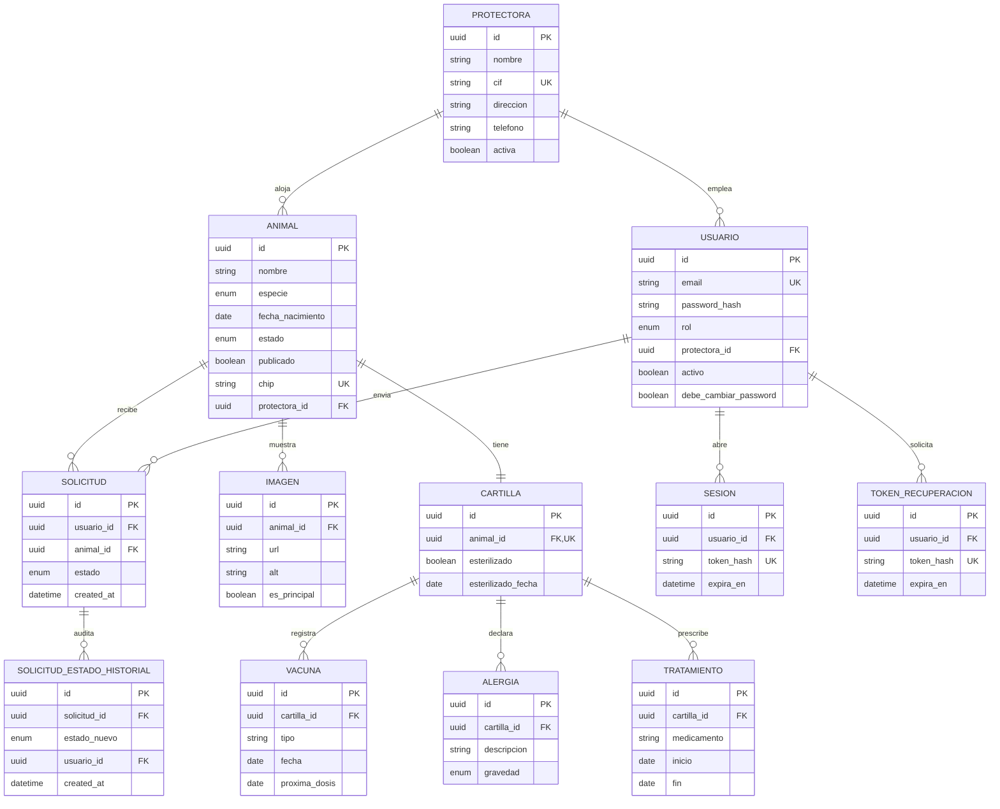

# 3.1.3. Modelo de datos

## 3.1.3.1. Elección del tipo de base de datos

El documento de análisis fijaba MongoDB Atlas, pero el modelo descrito allí (`id_usr`, `id_rol`, `id_prot`, claves foráneas) era **relacional en su estructura**. Tras revisar las alternativas (ver [ADR-02](../adr/README.md#adr-02)) se adopta **PostgreSQL gestionado con Prisma ORM**.

Razones concretas para este proyecto:

| Necesidad | Por qué PostgreSQL |
|---|---|
| Una sola solicitud aprobada por animal (RF-04) | Índice único parcial + transacción: la integridad la garantiza el motor, no el código |
| Solicitudes, animales y usuarios con relaciones claras | Claves foráneas reales, sin duplicidades huérfanas |
| Historial sanitario con fechas y orden | Consultas `ORDER BY`, agregados y filtros por fecha con índices |
| Cambios de esquema durante el desarrollo | Migraciones versionadas de Prisma, reproducibles en cualquier entorno |
| Trazabilidad y auditoría | `SolicitudEstadoHistorial` con integridad referencial |

Prisma aporta además **tipado generado** desde el esquema, lo que reduce errores entre el modelo y el código (RNF-06).

> Si el equipo decidiera finalmente una base documental, el modelo conceptual de este apartado se mantiene; solo cambiarían el `provider` de Prisma, los tipos de identificador y la forma de expresar las restricciones parciales. Es una decisión reversible, pero no gratuita.

## 3.1.3.2. Entidades

| Entidad | Propósito | Clave | Relaciones principales |
|---|---|---|---|
| **Protectora** | Centro que aloja animales y gestiona solicitudes | `id` (UUID) | 1:N con `Usuario` y `Animal` |
| **Usuario** | Persona con cuenta: adoptante, personal o administrador | `id` (UUID) | N:1 con `Protectora`; 1:N con `Solicitud`, `Sesion`, `TokenRecuperacion` |
| **Animal** | Animal en adopción | `id` (UUID) | N:1 con `Protectora`; 1:1 con `Cartilla`; 1:N con `Imagen` y `Solicitud` |
| **Cartilla** | Contenedor clínico del animal | `id` (UUID) | 1:1 con `Animal`; 1:N con `Vacuna`, `Alergia`, `Tratamiento` |
| **Vacuna** | Dosis administrada y próxima dosis | `id` (UUID) | N:1 con `Cartilla` |
| **Alergia** | Alergia detectada y su gravedad | `id` (UUID) | N:1 con `Cartilla` |
| **Tratamiento** | Medicación con inicio y fin | `id` (UUID) | N:1 con `Cartilla` |
| **Imagen** | Foto del animal y su texto alternativo | `id` (UUID) | N:1 con `Animal` |
| **Solicitud** | Petición de adopción y respuestas del formulario | `id` (UUID) | N:1 con `Usuario` y `Animal`; 1:N con historial |
| **SolicitudEstadoHistorial** | Auditoría de cada cambio de estado | `id` (UUID) | N:1 con `Solicitud` |
| **Sesion** | Sesión activa revocable | `id` (UUID) | N:1 con `Usuario` |
| **TokenRecuperacion** | Token de un solo uso para recuperar contraseña | `id` (UUID) | N:1 con `Usuario` |

## 3.1.3.3. Diagrama entidad-relación



## 3.1.3.4. Diccionario de datos

### Protectora

| Campo | Tipo | Nulo | Restricción | Descripción |
|---|---|---|---|---|
| `id` | UUID | No | PK | Identificador |
| `nombre` | Texto(120) | No | — | Nombre del centro |
| `cif` | Texto(20) | No | Único | CIF de la entidad |
| `direccion` | Texto(200) | No | — | Dirección física |
| `telefono` | Texto(20) | No | — | Contacto público |
| `email` | Texto(120) | Sí | Formato correo | Contacto público |
| `activa` | Booleano | No | Por defecto `true` | Si es `false`, sus animales no se publican |
| `createdAt` / `updatedAt` | Timestamp | No | — | Auditoría |

### Usuario

| Campo | Tipo | Nulo | Restricción | Descripción |
|---|---|---|---|---|
| `id` | UUID | No | PK | Identificador |
| `nombre` | Texto(100) | No | — | Nombre visible |
| `email` | Texto(254) | No | Único, minúsculas | Credencial de acceso |
| `passwordHash` | Texto | No | — | Argon2id; nunca se devuelve |
| `telefono` | Texto(20) | Sí | — | Contacto opcional |
| `rol` | Enum `Rol` | No | Por defecto `ADOPTANTE` | `ADMIN`, `PROTECTORA`, `ADOPTANTE` |
| `protectoraId` | UUID | Sí | FK → `Protectora`, `RESTRICT` | Obligatorio si `rol = PROTECTORA` (RI-10) |
| `activo` | Booleano | No | Por defecto `true` | Baja lógica |
| `debeCambiarPassword` | Booleano | No | Por defecto `false` | Contraseña temporal del personal |
| `consentimientoRgpd` | Booleano | No | Por defecto `false` | Aceptación de la política |
| `consentimientoFecha` | Timestamp | Sí | — | Fecha del consentimiento |
| `createdAt` / `updatedAt` | Timestamp | No | — | Auditoría |

### Animal

| Campo | Tipo | Nulo | Restricción | Descripción |
|---|---|---|---|---|
| `id` | UUID | No | PK | Identificador |
| `nombre` | Texto(80) | No | — | Nombre del animal |
| `especie` | Enum `Especie` | No | — | Perro, gato, conejo… |
| `raza` | Texto(80) | Sí | — | Raza o mestizo |
| `fechaNacimiento` | Fecha | No | ≤ hoy (RI-11) | **No se almacena la edad** (ADR-09) |
| `sexo` | Enum `Sexo` | No | Por defecto `DESCONOCIDO` | — |
| `tamano` | Enum `Tamano` | Sí | — | Pequeño, mediano, grande |
| `estado` | Enum `EstadoAnimal` | No | Por defecto `DISPONIBLE` | `ADOPTADO` solo por RF-04 |
| `descripcion` | Texto(2000) | Sí | — | Descripción pública |
| `aptoPiso` | Booleano | Sí | — | `null` = no consta |
| `chip` | Texto(20) | Sí | Único si no es nulo | Identificación legal |
| `publicado` | Booleano | No | Por defecto `true` | Borrado lógico |
| `publicadoEn` | Timestamp | Sí | — | Orden del catálogo |
| `protectoraId` | UUID | No | FK → `Protectora`, `RESTRICT` | Centro propietario |
| `createdAt` / `updatedAt` | Timestamp | No | — | Auditoría |

### Cartilla

| Campo | Tipo | Nulo | Restricción | Descripción |
|---|---|---|---|---|
| `id` | UUID | No | PK | Identificador |
| `animalId` | UUID | No | **Único**, FK → `Animal`, `CASCADE` | Relación 1:1 |
| `esterilizado` | Booleano | No | Por defecto `false` | Requisito legal |
| `esterilizadoFecha` | Fecha | Sí | — | Fecha de la intervención |
| `observaciones` | Texto(2000) | Sí | — | Notas del personal |
| `createdAt` / `updatedAt` | Timestamp | No | — | Auditoría |

### Vacuna

| Campo | Tipo | Nulo | Restricción | Descripción |
|---|---|---|---|---|
| `id` | UUID | No | PK | Identificador |
| `cartillaId` | UUID | No | FK → `Cartilla`, `CASCADE` | Cartilla del animal |
| `tipo` | Texto(80) | No | — | Rabia, polivalente… |
| `fecha` | Fecha | No | ≤ hoy | Fecha de administración |
| `proximaDosis` | Fecha | Sí | > `fecha` (RI-12) | Base de los recordatorios futuros |
| `veterinario` | Texto(120) | Sí | — | Profesional responsable |
| `lote` | Texto(40) | Sí | — | Trazabilidad del lote |
| `createdAt` | Timestamp | No | — | Auditoría |

### Alergia

| Campo | Tipo | Nulo | Restricción | Descripción |
|---|---|---|---|---|
| `id` | UUID | No | PK | Identificador |
| `cartillaId` | UUID | No | FK → `Cartilla`, `CASCADE` | Cartilla del animal |
| `descripcion` | Texto(200) | No | — | Alérgeno y reacción |
| `gravedad` | Enum `GravedadAlergia` | No | Por defecto `LEVE` | Solo las graves se publican |
| `createdAt` | Timestamp | No | — | Auditoría |

### Tratamiento

| Campo | Tipo | Nulo | Restricción | Descripción |
|---|---|---|---|---|
| `id` | UUID | No | PK | Identificador |
| `cartillaId` | UUID | No | FK → `Cartilla`, `CASCADE` | Cartilla del animal |
| `medicamento` | Texto(120) | No | — | Fármaco |
| `dosis` | Texto(80) | No | — | Pauta |
| `inicio` | Fecha | No | — | Inicio |
| `fin` | Fecha | Sí | ≥ `inicio` (RI-12) | Fin o `null` si sigue activo |
| `motivo` | Texto(300) | Sí | — | Indicación |
| `createdAt` | Timestamp | No | — | Auditoría |

### Imagen

| Campo | Tipo | Nulo | Restricción | Descripción |
|---|---|---|---|---|
| `id` | UUID | No | PK | Identificador |
| `animalId` | UUID | No | FK → `Animal`, `CASCADE` | Animal fotografiado |
| `url` | Texto(500) | No | — | URL en CDN |
| `publicId` | Texto(200) | Sí | — | Identificador en Cloudinary, para borrar |
| `alt` | Texto(160) | No | — | Texto alternativo (RNF-02) |
| `orden` | Entero | No | Por defecto 0 | Orden de la galería |
| `esPrincipal` | Booleano | No | Una sola por animal (RI-13) | Portada del catálogo |
| `createdAt` | Timestamp | No | — | Auditoría |

### Solicitud

| Campo | Tipo | Nulo | Restricción | Descripción |
|---|---|---|---|---|
| `id` | UUID | No | PK | Identificador |
| `usuarioId` | UUID | No | FK → `Usuario`, `RESTRICT` | Adoptante |
| `animalId` | UUID | No | FK → `Animal`, `RESTRICT` | Animal solicitado |
| `estado` | Enum `EstadoSolicitud` | No | Por defecto `PENDIENTE` | Máquina de estados (RI-07) |
| `vivienda` | Enum `TipoVivienda` | No | — | Piso, casa u otro |
| `viviendaAlquilada` | Booleano | No | Por defecto `false` | — |
| `permiteAnimales` | Booleano | Sí | — | Obligatorio si alquilada |
| `conviveConNinos` | Booleano | No | — | — |
| `otrasMascotas` | Texto(500) | Sí | — | — |
| `horasSolo` | Entero | No | 0–24 (RI-14) | Horas diarias solo |
| `experienciaPrevia` | Texto(1000) | Sí | — | — |
| `motivacion` | Texto(1000) | No | ≥ 50 caracteres (RI-14) | — |
| `consentimientoRgpd` | Booleano | No | Debe ser `true` | — |
| `consentimientoFecha` | Timestamp | No | Fijada en servidor | Prueba del consentimiento |
| `motivoRechazo` | Texto(500) | Sí | Obligatorio al rechazar | Visible para el adoptante |
| `decididaPorId` | UUID | Sí | FK → `Usuario`, `SET NULL` | Quién resolvió |
| `decididaEn` | Timestamp | Sí | — | Cuándo |
| `createdAt` / `updatedAt` | Timestamp | No | — | Auditoría |

**Mascotas del adoptante.** No se crea una entidad «mascota» aparte: las mascotas de un perfil son los animales con una `Solicitud` en estado `APROBADA` para ese `usuarioId`. Esa relación derivada alimenta la pantalla 14 (perfil) y la 15 (cartilla en lectura), y evita duplicar el vínculo persona–animal que ya guarda la adopción. El adoptante consulta la cartilla completa del animal adoptado, pero solo el personal puede escribir en ella (ADR-07).

### SolicitudEstadoHistorial

| Campo | Tipo | Nulo | Restricción | Descripción |
|---|---|---|---|---|
| `id` | UUID | No | PK | Identificador |
| `solicitudId` | UUID | No | FK → `Solicitud`, `CASCADE` | Solicitud auditada |
| `estadoAnterior` | Enum | Sí | — | `null` en la creación |
| `estadoNuevo` | Enum | No | — | Estado resultante |
| `usuarioId` | UUID | Sí | — | Autor del cambio |
| `comentario` | Texto(500) | Sí | — | Motivo o nota |
| `createdAt` | Timestamp | No | — | Momento exacto |

### Sesion

| Campo | Tipo | Nulo | Restricción | Descripción |
|---|---|---|---|---|
| `id` | UUID | No | PK | Identificador |
| `usuarioId` | UUID | No | FK → `Usuario`, `CASCADE` | Propietario |
| `tokenHash` | Texto | No | **Único** | SHA-256 del token; el token en claro no se guarda |
| `expiraEn` | Timestamp | No | — | 7 días desde la creación |
| `revocadaEn` | Timestamp | Sí | — | Cierre de sesión o cambio de contraseña |
| `userAgent` | Texto(300) | Sí | — | Diagnóstico |
| `ip` | Texto(45) | Sí | — | IPv4/IPv6 |
| `creadaEn` | Timestamp | No | — | Auditoría |

### TokenRecuperacion

| Campo | Tipo | Nulo | Restricción | Descripción |
|---|---|---|---|---|
| `id` | UUID | No | PK | Identificador |
| `usuarioId` | UUID | No | FK → `Usuario`, `CASCADE` | Propietario |
| `tokenHash` | Texto | No | **Único** | Hash del token enviado por correo |
| `expiraEn` | Timestamp | No | — | 1 hora |
| `usadoEn` | Timestamp | Sí | — | Un solo uso |
| `createdAt` | Timestamp | No | — | Auditoría |

## 3.1.3.5. Enumeraciones

| Enum | Valores | Motivo |
|---|---|---|
| `Rol` | `ADMIN`, `PROTECTORA`, `ADOPTANTE` | Control de acceso fijo; no se gestionan roles dinámicos (ADR-05) |
| `Especie` | `PERRO`, `GATO`, `CONEJO`, `COBAYA`, `HURON`, `OTRO` | Filtro del catálogo |
| `Sexo` | `MACHO`, `HEMBRA`, `DESCONOCIDO` | Datos descriptivos |
| `Tamano` | `PEQUENO`, `MEDIANO`, `GRANDE` | Filtro del catálogo y aptitud para vivienda |
| `EstadoAnimal` | `DISPONIBLE`, `RESERVADO`, `EN_ACOGIDA`, `ADOPTADO`, `NO_ADOPTABLE` | Catálogo y reglas de negocio |
| `EstadoSolicitud` | `PENDIENTE`, `EN_REVISION`, `APROBADA`, `RECHAZADA`, `CANCELADA` | Máquina de estados de RF-04 |
| `GravedadAlergia` | `LEVE`, `MODERADA`, `GRAVE` | Solo `GRAVE` se publica en la ficha |
| `TipoVivienda` | `PISO`, `CASA`, `OTRO` | Evaluación de la solicitud |

## 3.1.3.6. Esquema Prisma

Esquema de referencia del diseño. Se versiona en `apps/api/prisma/schema.prisma` durante la implementación.

```prisma
generator client {
  provider = "prisma-client-js"
}

datasource db {
  provider = "postgresql"
  url      = env("DATABASE_URL")
}

enum Rol {
  ADMIN
  PROTECTORA
  ADOPTANTE
}

enum Especie {
  PERRO
  GATO
  CONEJO
  COBAYA
  HURON
  OTRO
}

enum Sexo {
  MACHO
  HEMBRA
  DESCONOCIDO
}

enum Tamano {
  PEQUENO
  MEDIANO
  GRANDE
}

enum EstadoAnimal {
  DISPONIBLE
  RESERVADO
  EN_ACOGIDA
  ADOPTADO
  NO_ADOPTABLE
}

enum EstadoSolicitud {
  PENDIENTE
  EN_REVISION
  APROBADA
  RECHAZADA
  CANCELADA
}

enum GravedadAlergia {
  LEVE
  MODERADA
  GRAVE
}

enum TipoVivienda {
  PISO
  CASA
  OTRO
}

model Protectora {
  id        String   @id @default(uuid()) @db.Uuid
  nombre    String   @db.VarChar(120)
  cif       String   @unique @db.VarChar(20)
  direccion String   @db.VarChar(200)
  telefono  String   @db.VarChar(20)
  email     String?  @db.VarChar(120)
  activa    Boolean  @default(true)
  createdAt DateTime @default(now())
  updatedAt DateTime @updatedAt

  usuarios Usuario[]
  animales Animal[]

  @@map("protectoras")
}

model Usuario {
  id                   String    @id @default(uuid()) @db.Uuid
  nombre               String    @db.VarChar(100)
  email                String    @unique @db.VarChar(254)
  passwordHash         String
  telefono             String?   @db.VarChar(20)
  rol                  Rol       @default(ADOPTANTE)
  protectoraId         String?   @db.Uuid
  activo               Boolean   @default(true)
  debeCambiarPassword  Boolean   @default(false)
  consentimientoRgpd   Boolean   @default(false)
  consentimientoFecha  DateTime?
  createdAt            DateTime  @default(now())
  updatedAt            DateTime  @updatedAt

  protectora Protectora? @relation(fields: [protectoraId], references: [id], onDelete: Restrict)

  solicitudes Solicitud[]          @relation("SolicitudAdoptante")
  decisiones  Solicitud[]          @relation("SolicitudDecision")
  sesiones    Sesion[]
  tokens      TokenRecuperacion[]

  @@index([protectoraId])
  @@map("usuarios")
}

model Animal {
  id              String       @id @default(uuid()) @db.Uuid
  nombre          String       @db.VarChar(80)
  especie         Especie
  raza            String?      @db.VarChar(80)
  fechaNacimiento DateTime     @db.Date
  sexo            Sexo         @default(DESCONOCIDO)
  tamano          Tamano?
  estado          EstadoAnimal @default(DISPONIBLE)
  descripcion     String?      @db.VarChar(2000)
  aptoPiso        Boolean?
  chip            String?      @unique @db.VarChar(20)
  publicado       Boolean      @default(true)
  publicadoEn     DateTime?
  protectoraId    String       @db.Uuid
  createdAt       DateTime     @default(now())
  updatedAt       DateTime     @updatedAt

  protectora  Protectora @relation(fields: [protectoraId], references: [id], onDelete: Restrict)
  cartilla    Cartilla?
  imagenes    Imagen[]
  solicitudes Solicitud[]

  @@index([publicado, estado])
  @@index([especie, estado])
  @@index([protectoraId])
  @@map("animales")
}

model Cartilla {
  id                String    @id @default(uuid()) @db.Uuid
  animalId          String    @unique @db.Uuid
  esterilizado      Boolean   @default(false)
  esterilizadoFecha DateTime? @db.Date
  observaciones     String?   @db.VarChar(2000)
  createdAt         DateTime  @default(now())
  updatedAt         DateTime  @updatedAt

  animal Animal @relation(fields: [animalId], references: [id], onDelete: Cascade)

  vacunas      Vacuna[]
  alergias     Alergia[]
  tratamientos Tratamiento[]

  @@map("cartillas")
}

model Vacuna {
  id           String    @id @default(uuid()) @db.Uuid
  cartillaId   String    @db.Uuid
  tipo         String    @db.VarChar(80)
  fecha        DateTime  @db.Date
  proximaDosis DateTime? @db.Date
  veterinario  String?   @db.VarChar(120)
  lote         String?   @db.VarChar(40)
  createdAt    DateTime  @default(now())

  cartilla Cartilla @relation(fields: [cartillaId], references: [id], onDelete: Cascade)

  @@index([cartillaId, fecha])
  @@index([proximaDosis])
  @@map("vacunas")
}

model Alergia {
  id          String          @id @default(uuid()) @db.Uuid
  cartillaId  String          @db.Uuid
  descripcion String          @db.VarChar(200)
  gravedad    GravedadAlergia @default(LEVE)
  createdAt   DateTime        @default(now())

  cartilla Cartilla @relation(fields: [cartillaId], references: [id], onDelete: Cascade)

  @@index([cartillaId])
  @@map("alergias")
}

model Tratamiento {
  id          String    @id @default(uuid()) @db.Uuid
  cartillaId  String    @db.Uuid
  medicamento String    @db.VarChar(120)
  dosis       String    @db.VarChar(80)
  inicio      DateTime  @db.Date
  fin         DateTime? @db.Date
  motivo      String?   @db.VarChar(300)
  createdAt   DateTime  @default(now())

  cartilla Cartilla @relation(fields: [cartillaId], references: [id], onDelete: Cascade)

  @@index([cartillaId])
  @@map("tratamientos")
}

model Imagen {
  id          String   @id @default(uuid()) @db.Uuid
  animalId    String   @db.Uuid
  url         String   @db.VarChar(500)
  publicId    String?  @db.VarChar(200)
  alt         String   @db.VarChar(160)
  orden       Int      @default(0)
  esPrincipal Boolean  @default(false)
  createdAt   DateTime @default(now())

  animal Animal @relation(fields: [animalId], references: [id], onDelete: Cascade)

  @@index([animalId, orden])
  @@map("imagenes")
}

model Solicitud {
  id                  String          @id @default(uuid()) @db.Uuid
  usuarioId           String          @db.Uuid
  animalId            String          @db.Uuid
  estado              EstadoSolicitud @default(PENDIENTE)
  vivienda            TipoVivienda
  viviendaAlquilada   Boolean         @default(false)
  permiteAnimales     Boolean?
  conviveConNinos     Boolean         @default(false)
  otrasMascotas       String?         @db.VarChar(500)
  horasSolo           Int
  experienciaPrevia   String?         @db.VarChar(1000)
  motivacion          String          @db.VarChar(1000)
  consentimientoRgpd  Boolean
  consentimientoFecha DateTime
  motivoRechazo       String?         @db.VarChar(500)
  decididaPorId       String?         @db.Uuid
  decididaEn          DateTime?
  createdAt           DateTime        @default(now())
  updatedAt           DateTime        @updatedAt

  usuario    Usuario  @relation("SolicitudAdoptante", fields: [usuarioId], references: [id], onDelete: Restrict)
  animal     Animal   @relation(fields: [animalId], references: [id], onDelete: Restrict)
  decididaPor Usuario? @relation("SolicitudDecision", fields: [decididaPorId], references: [id], onDelete: SetNull)
  historial  SolicitudEstadoHistorial[]

  @@index([usuarioId, estado])
  @@index([animalId, estado])
  @@index([estado, createdAt])
  @@map("solicitudes")
}

model SolicitudEstadoHistorial {
  id             String           @id @default(uuid()) @db.Uuid
  solicitudId    String           @db.Uuid
  estadoAnterior EstadoSolicitud?
  estadoNuevo    EstadoSolicitud
  usuarioId      String?          @db.Uuid
  comentario     String?          @db.VarChar(500)
  createdAt      DateTime         @default(now())

  solicitud Solicitud @relation(fields: [solicitudId], references: [id], onDelete: Cascade)

  @@index([solicitudId, createdAt])
  @@map("solicitud_historial")
}

model Sesion {
  id         String    @id @default(uuid()) @db.Uuid
  usuarioId  String    @db.Uuid
  tokenHash  String    @unique
  expiraEn   DateTime
  revocadaEn DateTime?
  userAgent  String?   @db.VarChar(300)
  ip         String?   @db.VarChar(45)
  creadaEn   DateTime  @default(now())

  usuario Usuario @relation(fields: [usuarioId], references: [id], onDelete: Cascade)

  @@index([usuarioId])
  @@map("sesiones")
}

model TokenRecuperacion {
  id        String    @id @default(uuid()) @db.Uuid
  usuarioId String    @db.Uuid
  tokenHash String    @unique
  expiraEn  DateTime
  usadoEn   DateTime?
  createdAt DateTime  @default(now())

  usuario Usuario @relation(fields: [usuarioId], references: [id], onDelete: Cascade)

  @@index([usuarioId])
  @@map("tokens_recuperacion")
}
```

## 3.1.3.7. Reglas de integridad

| ID | Regla | Dónde se garantiza |
|---|---|---|
| **RI-01** | El `email` es único y se normaliza a minúsculas | Servicio + índice único |
| **RI-02** | El `cif` de la protectora es único | `@unique` |
| **RI-03** | El `chip` es único si existe; varios animales pueden no tenerlo | `@unique` sobre campo nullable (PostgreSQL admite varios `NULL`) |
| **RI-04** | Cada animal tiene exactamente una cartilla | `Cartilla.animalId @unique` |
| **RI-05** | Un usuario no puede tener dos solicitudes **activas** para el mismo animal | Índice único parcial (SQL) |
| **RI-06** | Un animal no puede tener dos solicitudes **aprobadas** | Índice único parcial (SQL) |
| **RI-07** | Solo se permiten las transiciones de estado de RF-04 | Servicio + enum |
| **RI-08** | Aprobar una solicitud actualiza animal y resto de solicitudes en una transacción | `prisma.$transaction` |
| **RI-09** | Usuarios se anonimizan; no se borran si tienen solicitudes | Servicio + `onDelete: Restrict` |
| **RI-10** | `rol = PROTECTORA` exige `protectoraId`; otros roles no lo exigen | CHECK en SQL + validación de servicio |
| **RI-11** | `fechaNacimiento` no puede ser futura | CHECK en SQL + Zod |
| **RI-12** | `proximaDosis > fecha` y `fin ≥ inicio` | CHECK en SQL + Zod |
| **RI-13** | Como máximo una imagen principal por animal | Índice único parcial (SQL) |
| **RI-14** | `horasSolo` entre 0 y 24 y `motivacion` ≥ 50 caracteres | CHECK en SQL + Zod |
| **RI-15** | La protectora del animal se toma de la sesión, nunca del cuerpo | Servicio |
| **RI-16** | Una protectora inactiva no publica animales | Servicio (consulta del catálogo) |

### Restricciones que Prisma no expresa directamente

Se añaden en una migración SQL versionada:

```sql
-- RI-05: una sola solicitud activa por usuario y animal
CREATE UNIQUE INDEX solicitud_activa_unica
  ON solicitudes ("usuarioId", "animalId")
  WHERE estado IN ('PENDIENTE', 'EN_REVISION', 'APROBADA');

-- RI-06: una sola solicitud aprobada por animal
CREATE UNIQUE INDEX solicitud_aprobada_unica
  ON solicitudes ("animalId")
  WHERE estado = 'APROBADA';

-- RI-13: una sola imagen principal por animal
CREATE UNIQUE INDEX imagen_principal_unica
  ON imagenes ("animalId")
  WHERE "esPrincipal" = true;

-- RI-10: coherencia entre rol y protectora
ALTER TABLE usuarios
  ADD CONSTRAINT usuario_protectora_chk
  CHECK (
    (rol = 'PROTECTORA' AND "protectoraId" IS NOT NULL)
    OR (rol <> 'PROTECTORA')
  );

-- RI-11 y RI-12
ALTER TABLE animales
  ADD CONSTRAINT animal_nacimiento_chk
  CHECK ("fechaNacimiento" <= CURRENT_DATE);

ALTER TABLE vacunas
  ADD CONSTRAINT vacuna_fechas_chk
  CHECK ("proximaDosis" IS NULL OR "proximaDosis" > fecha);

ALTER TABLE tratamientos
  ADD CONSTRAINT tratamiento_fechas_chk
  CHECK (fin IS NULL OR fin >= inicio);

-- RI-14
ALTER TABLE solicitudes
  ADD CONSTRAINT solicitud_horas_chk CHECK ("horasSolo" BETWEEN 0 AND 24);

ALTER TABLE solicitudes
  ADD CONSTRAINT solicitud_motivacion_chk CHECK (char_length(motivacion) >= 50);
```

**Decisión consciente:** las reglas se aplican en **dos niveles**. El servicio da mensajes comprensibles (422 con detalle por campo); la base de datos actúa como última barrera frente a errores de código o accesos concurrentes. Sin ese segundo nivel, dos peticiones simultáneas podrían dejar datos inconsistentes, que es justo el riesgo que advierte la guía.

## 3.1.3.8. Índices y justificación

| Índice | Consulta que lo usa | Motivo |
|---|---|---|
| `(publicado, estado)` | Catálogo público | Filtro base de todas las visitas |
| `(especie, estado)` | Filtro por especie | Filtro más usado del catálogo |
| `(protectoraId)` en `Animal` | Panel de la protectora | Aislamiento por centro |
| `(cartillaId, fecha)` en `Vacuna` | Cartilla ordenada | Evita ordenar en memoria |
| `(proximaDosis)` en `Vacuna` | Futuro panel de próximas dosis | Deja preparada la fase 2 |
| `(usuarioId, estado)` en `Solicitud` | "Mis solicitudes" | Consulta personal |
| `(animalId, estado)` en `Solicitud` | Panel de solicitudes por animal | Filtro del personal |
| `(estado, createdAt)` en `Solicitud` | Bandeja de entrada | Orden cronológico con filtro |
| `(solicitudId, createdAt)` en historial | Línea de tiempo | Orden por fecha |

No se indexa «por si acaso»: cada índice tiene una consulta asignada y un coste de escritura. Los índices que no se usen en las pruebas se eliminan antes de la entrega.

## 3.1.3.9. Borrado, retención y privacidad

| Caso | Política | Justificación |
|---|---|---|
| Animal con historial | Borrado lógico (`publicado = false`) | Conserva cartilla y solicitudes para trazabilidad |
| Imagen | Borrado físico en base de datos y en el CDN | No tiene valor histórico |
| Registro sanitario | Borrado físico con confirmación | Dato corregible; se registra la acción en el log |
| Cuenta de adoptante | **Anonimización**: nombre genérico, correo sustituido, contraseña aleatoria, teléfono a `null` | Mantiene la trazabilidad de adopciones sin conservar datos personales |
| Solicitud | Se conserva; se elimina el motivo libre si contiene datos personales al anonimizar | Interés legítimo y obligaciones de trazabilidad |
| Protectora | Baja lógica (`activa = false`) | Sus animales dejan de publicarse, pero el historial se conserva |
| Sesiones y tokens | Borrado en cascada al eliminar la cuenta; revocación al cambiar contraseña | Seguridad |

**Retención propuesta:** las solicitudes resueltas se conservan **5 años** desde su resolución, plazo habitual para documentación de adopción, y después se anonimizan por completo. Es una propuesta a validar antes de la entrega; no se implementa un proceso automático en el MVP.

**Minimización aplicada al catálogo público:** la respuesta pública incluye nombre, especie, raza, edad calculada, tamaño, sexo, descripción, imágenes, estado, protectora y un **resumen** de la cartilla (vacunado al día, esterilizado, chip sí/no, alergias graves, apto para piso). No incluye vacunas concretas, tratamientos, observaciones, datos del adoptante ni correo del personal.

## 3.1.3.10. Migraciones, semilla y evolución

- **Migraciones:** `prisma migrate dev` en desarrollo y `prisma migrate deploy` en despliegue. Cada migración se revisa antes de aplicarla y se versiona en el repositorio.
- **Semilla:** script `prisma/seed.ts` reproducible con 3 protectoras, 30 animales, cartillas completas, usuarios de los tres roles y solicitudes en todos los estados. Permite demostrar estados vacíos y estados con datos.
- **Datos personales en la semilla:** ficticios y sin relación con personas reales.
- **Entidades previstas para fase 2** (no se implementan ahora): `Recordatorio` (vacuna, fecha de aviso, canal, enviado), `Documento` (contrato PDF firmado) y `EventoAuditoria` genérico para acciones administrativas.

## 3.1.3.11. Trazabilidad requisito → entidad

| Requisito | Entidades implicadas |
|---|---|
| RF-01 | `Animal`, `Imagen`, `Cartilla`, `Vacuna`, `Alergia`, `Protectora` |
| RF-02 | `Cartilla`, `Vacuna`, `Alergia`, `Tratamiento`, `Animal` |
| RF-03 | `Solicitud`, `Usuario`, `Animal`, `SolicitudEstadoHistorial` |
| RF-04 | `Solicitud`, `SolicitudEstadoHistorial`, `Animal`, `Usuario` |
| RF-05 | `Animal`, `Imagen`, `Protectora` |
| RF-06, RF-07, RF-11 | `Usuario`, `Sesion`, `TokenRecuperacion` |
| RF-08, RF-09 | `Solicitud`, `SolicitudEstadoHistorial` |
| RF-10 | `Usuario`, `Protectora` |
| RF-12 | `Usuario`, `Solicitud` (anonimización) |
