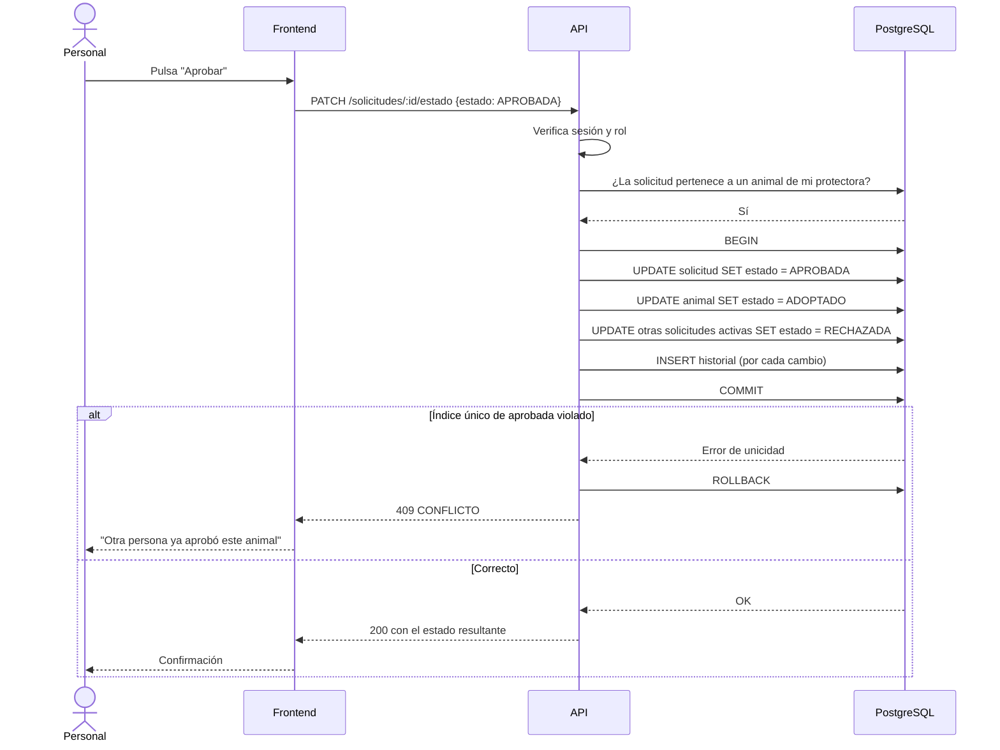

# 3.1.4. Contratos de API

## Convenciones generales

| Aspecto | Decisión |
|---|---|
| Estilo | API REST sobre HTTPS |
| Prefijo y versión | `/api/v1` — la versión va en la ruta para permitir cambios incompatibles |
| Formato | JSON UTF-8; fechas en ISO 8601 (`2026-11-15` para fechas sin hora, `2026-11-15T10:30:00Z` para timestamps) |
| Nomenclatura | Recursos en plural y en español; campos en `camelCase` |
| Autenticación | Cookie de sesión `pt_session` (`HttpOnly`, `Secure`, `SameSite=Lax`) |
| Autorización | Middleware de rol + verificación de pertenencia en el servicio |
| Validación | Zod en el servidor; errores por campo con código 422 |
| Paginación | `?pagina=1&limite=12` (máximo 48) |
| Ordenación | `?orden=recientes` o `?orden=antiguos`; el resto de listados tiene orden fijo |
| Filtros | Parámetros de consulta; los del catálogo son combinables |
| Idempotencia | `GET`, `PUT`, `PATCH` y `DELETE` son idempotentes; `POST` no, salvo que se indique |
| CORS | Solo el origen del frontend, con credenciales |
| CSRF | `SameSite=Lax` + comprobación del encabezado `Origin` en `POST`, `PATCH` y `DELETE` |
| Límite de peticiones | 100 peticiones/minuto por IP en general; límites específicos en login y recuperación |

### Formato de respuesta

**Recurso individual**

```json
{
  "datos": { "id": "…", "nombre": "Luna" }
}
```

**Listado paginado**

```json
{
  "datos": [],
  "meta": { "pagina": 1, "limite": 12, "total": 137, "totalPaginas": 12 }
}
```

**Error**

```json
{
  "error": {
    "codigo": "VALIDACION",
    "mensaje": "Revisa los campos marcados.",
    "detalles": [
      { "campo": "motivacion", "mensaje": "Debe tener al menos 50 caracteres." }
    ]
  }
}
```

El `mensaje` es siempre comprensible para el usuario. Nunca incluye trazas, rutas internas, consultas SQL ni nombres de tablas.

### Catálogo de errores

| HTTP | `codigo` | Cuándo |
|---|---|---|
| 400 | `PETICION_INVALIDA` | JSON mal formado, parámetro no interpretable, token caducado |
| 401 | `NO_AUTENTICADO` | Sin sesión válida o sesión revocada |
| 403 | `SIN_PERMISO` | Autenticado pero sin permiso sobre el recurso (incluye otro `protectoraId`) |
| 404 | `NO_ENCONTRADO` | No existe o no es visible según las reglas (no se distingue de "no existe") |
| 409 | `CONFLICTO` | Estado incompatible: animal no disponible, solicitud duplicada, transición no permitida, CIF o chip repetido |
| 422 | `VALIDACION` | Datos que no cumplen las reglas, con detalle por campo |
| 429 | `DEMASIADAS_PETICIONES` | Límite de intentos o de peticiones superado |
| 500 | `ERROR_INTERNO` | Fallo inesperado; el detalle solo queda en el log |

**Decisión:** un recurso de otra protectora devuelve **403** cuando el usuario está autenticado y el recurso existe, y **404** cuando el recurso no existe o no debe revelarse (animal no publicado). Así se evita filtrar información sin confundir al personal legítimo.

## Autenticación y permisos

### Flujo de sesión

1. `POST /auth/login` valida credenciales y crea una fila en `sesiones` con el **hash** del token.
2. El token en claro viaja en la cookie `pt_session`. La base de datos nunca lo guarda.
3. Cada petición autenticada calcula el hash del token recibido y busca una sesión no revocada y no caducada.
4. `POST /auth/logout` marca `revocadaEn`, por lo que la cookie deja de servir inmediatamente.
5. Cambiar o restablecer la contraseña revoca **todas** las sesiones del usuario.

### Matriz de permisos

| Recurso / acción | Visitante | Adoptante | Personal | Admin |
|---|---|---|---|---|
| Ver catálogo y ficha pública | ✅ | ✅ | ✅ | ✅ |
| Registrarse, iniciar sesión | ✅ | — | — | — |
| Solicitar adopción | ❌ | ✅ | ✅ (no de su protectora) | ✅ (no de su protectora) |
| Ver sus propias solicitudes | ❌ | ✅ | ✅ | ✅ |
| Cancelar solicitud propia | ❌ | ✅ | ✅ | ✅ |
| Ver solicitudes de la protectora | ❌ | ❌ | ✅ (solo las suyas) | ✅ (todas) |
| Cambiar estado de solicitud | ❌ | ❌ | ✅ (solo las suyas) | ✅ |
| Ver cartilla completa | ❌ | ❌ | ✅ (solo sus animales) | ✅ |
| Crear y editar animales | ❌ | ❌ | ✅ (solo su protectora) | ✅ |
| Gestionar cuentas y protectoras | ❌ | ❌ | ❌ | ✅ |
| Eliminar su propia cuenta | ❌ | ✅ | ✅ | ✅ |

> La matriz se aplica en el servidor. Ocultar un botón en la interfaz es una mejora de usabilidad, **no** un control de seguridad (RNF-03).

## Endpoints

### Autenticación

| ID | Método y ruta | Finalidad | Acceso | RF |
|---|---|---|---|---|
| A-01 | `POST /api/v1/auth/registro` | Crear cuenta de adoptante | Público | RF-06 |
| A-02 | `POST /api/v1/auth/login` | Iniciar sesión | Público | RF-07 |
| A-03 | `POST /api/v1/auth/logout` | Cerrar sesión y revocarla | Autenticado | RF-07 |
| A-04 | `GET /api/v1/auth/me` | Usuario de la sesión actual | Autenticado | RF-07 |
| A-05 | `POST /api/v1/auth/password/recuperar` | Solicitar enlace de recuperación | Público | RF-11 |
| A-06 | `POST /api/v1/auth/password/restablecer` | Establecer nueva contraseña con token | Público | RF-11 |

**A-01 · Registro**

```http
POST /api/v1/auth/registro
Content-Type: application/json

{
  "nombre": "Carlos Pérez",
  "email": "carlos@example.com",
  "password": "Adopta2026",
  "telefono": "600123456",
  "consentimientoRgpd": true
}
```

| Respuesta | Cuerpo |
|---|---|
| `201` | `{ "datos": { "id": "…", "nombre": "Carlos Pérez", "email": "carlos@example.com", "rol": "ADOPTANTE" } }` + cookie `pt_session` |
| `409` | `CONFLICTO`: correo ya registrado |
| `422` | `VALIDACION`: contraseña débil, correo inválido o consentimiento ausente |
| `429` | `DEMASIADAS_PETICIONES` |

El campo `rol` se ignora si llega en el cuerpo (CA-06.5). `passwordHash` no se serializa nunca.

**A-02 · Login**

| Respuesta | Cuerpo |
|---|---|
| `200` | `{ "datos": { "id", "nombre", "email", "rol", "protectora": { "id", "nombre" } \| null } }` |
| `401` | `NO_AUTENTICADO` con mensaje genérico |
| `403` | `SIN_PERMISO`: cuenta desactivada |
| `429` | Tras 5 fallos en 15 minutos |

### Catálogo público

| ID | Método y ruta | Finalidad | Acceso | RF |
|---|---|---|---|---|
| C-01 | `GET /api/v1/animales` | Listado filtrable y paginado | Público | RF-01 |
| C-02 | `GET /api/v1/animales/:id` | Ficha pública con resumen de cartilla | Público | RF-01 |
| C-03 | `GET /api/v1/protectoras` | Protectoras activas (para el filtro) | Público | RF-01 |

**C-01 · Parámetros**

| Parámetro | Valores | Por defecto |
|---|---|---|
| `pagina` | entero ≥ 1 | 1 |
| `limite` | 1–48 | 12 |
| `especie` | `PERRO`, `GATO`, `CONEJO`, `COBAYA`, `HURON`, `OTRO` | — |
| `edad` | `CACHORRO`, `JOVEN`, `ADULTO`, `SENIOR` | — |
| `tamano` | `PEQUENO`, `MEDIANO`, `GRANDE` | — |
| `protectora` | UUID | — |
| `aptoPiso` | `true` / `false` | — |
| `orden` | `recientes`, `antiguos` | `recientes` |

**C-01 · Respuesta `200`**

```json
{
  "datos": [
    {
      "id": "8f2c…",
      "nombre": "Luna",
      "especie": "PERRO",
      "raza": "Mestiza",
      "edadMeses": 26,
      "sexo": "HEMBRA",
      "tamano": "MEDIANO",
      "estado": "DISPONIBLE",
      "aptoPiso": true,
      "protectora": { "id": "b1a0…", "nombre": "Protectora de Valencia" },
      "imagenPrincipal": { "url": "https://…/luna.webp", "alt": "Luna, perra mestiza de pelo claro, sentada en el jardín" },
      "resumenCartilla": {
        "vacunadoAlDia": true,
        "esterilizado": true,
        "tieneChip": true,
        "alergiasGraves": []
      }
    }
  ],
  "meta": { "pagina": 1, "limite": 12, "total": 137, "totalPaginas": 12 }
}
```

`edadMeses` se calcula en el servidor con la fecha de la consulta (CA-01.6). El rango de edad se traduce internamente a un filtro sobre `fechaNacimiento`.

| Respuesta | Cuándo |
|---|---|
| `200` | Listado correcto, incluso vacío (`datos: []`, `total: 0`) |
| `400` | `PETICION_INVALIDA` si `limite > 48` o un filtro tiene un valor no permitido |
| `404` (en C-02) | Animal no publicado, adoptado o de protectora inactiva |

### Gestión de animales

| ID | Método y ruta | Finalidad | Acceso | RF |
|---|---|---|---|---|
| AN-01 | `POST /api/v1/animales` | Alta de animal | Personal, Admin | RF-05 |
| AN-02 | `PATCH /api/v1/animales/:id` | Editar animal | Personal dueño, Admin | RF-05 |
| AN-03 | `DELETE /api/v1/animales/:id` | Archivar (borrado lógico) | Personal dueño, Admin | RF-05 |
| AN-04 | `POST /api/v1/animales/:id/imagenes` | Subir imagen (`multipart/form-data`) | Personal dueño, Admin | RF-05 |
| AN-05 | `PATCH /api/v1/animales/:id/imagenes/:imagenId` | Cambiar orden, principal o texto alternativo | Personal dueño, Admin | RF-05 |
| AN-06 | `DELETE /api/v1/imagenes/:imagenId` | Eliminar imagen | Personal dueño, Admin | RF-05 |

**AN-01 · Cuerpo**

```json
{
  "nombre": "Luna",
  "especie": "PERRO",
  "raza": "Mestiza",
  "fechaNacimiento": "2024-09-01",
  "sexo": "HEMBRA",
  "tamano": "MEDIANO",
  "descripcion": "Muy sociable con personas y con otros perros. Busca una familia con patio o piso con paseos largos.",
  "aptoPiso": true,
  "chip": "941000012345678"
}
```

- La `protectoraId` se toma de la sesión (RI-15). Si el cuerpo la incluye, se ignora.
- El animal se crea con su cartilla vacía en la misma transacción (CA-02.7).
- `estado` no se acepta en el alta: siempre nace `DISPONIBLE`.

| Respuesta | Cuándo |
|---|---|
| `201` | Creado con `id` y `cartillaId` |
| `403` | El usuario no es personal |
| `409` | Chip duplicado |
| `422` | Campos obligatorios, fecha futura, descripción demasiado corta |

**AN-04 · Imagen**

| Restricción | Valor |
|---|---|
| Formatos | JPG, PNG, WebP |
| Tamaño máximo | 5 MB |
| Máximo por animal | 6 |
| Campos obligatorios | `archivo`, `alt` (5–160 caracteres) |
| Respuesta | `201` con `{ id, url, alt, orden, esPrincipal }` |
| Errores | `422` formato o tamaño; `409` si ya hay 6 imágenes |

### Cartilla Digital

| ID | Método y ruta | Finalidad | Acceso | RF |
|---|---|---|---|---|
| CA-01 | `GET /api/v1/animales/:id/cartilla` | Cartilla completa | Personal dueño, Admin | RF-02 |
| CA-02 | `PATCH /api/v1/animales/:id/cartilla` | Esterilización y observaciones | Personal dueño, Admin | RF-02 |
| CA-03 | `POST /api/v1/animales/:id/cartilla/vacunas` | Registrar vacuna | Personal dueño, Admin | RF-02 |
| CA-04 | `PATCH /api/v1/vacunas/:vacunaId` | Editar vacuna | Personal dueño, Admin | RF-02 |
| CA-05 | `DELETE /api/v1/vacunas/:vacunaId` | Eliminar vacuna | Personal dueño, Admin | RF-02 |
| CA-06 | `POST /api/v1/animales/:id/cartilla/alergias` | Registrar alergia | Personal dueño, Admin | RF-02 |
| CA-07 | `PATCH /api/v1/alergias/:alergiaId` | Editar alergia | Personal dueño, Admin | RF-02 |
| CA-08 | `DELETE /api/v1/alergias/:alergiaId` | Eliminar alergia | Personal dueño, Admin | RF-02 |
| CA-09 | `POST /api/v1/animales/:id/cartilla/tratamientos` | Registrar tratamiento | Personal dueño, Admin | RF-02 |
| CA-10 | `PATCH /api/v1/tratamientos/:tratamientoId` | Editar tratamiento | Personal dueño, Admin | RF-02 |
| CA-11 | `DELETE /api/v1/tratamientos/:tratamientoId` | Eliminar tratamiento | Personal dueño, Admin | RF-02 |

> **Nota de nomenclatura:** en este apartado `CA-xx` son identificadores de operación de la API, distintos de los criterios de aceptación `CA-02.x` del documento de requisitos. En la implementación se usarán prefijos distintos (`OP-CART-01`) para evitar ambigüedad.

**CA-01 · Respuesta `200`**

```json
{
  "datos": {
    "id": "c4d1…",
    "animalId": "8f2c…",
    "esterilizado": true,
    "esterilizadoFecha": "2025-03-12",
    "observaciones": "Requiere pienso hipoalergénico.",
    "vacunadoAlDia": true,
    "vacunas": [
      { "id": "v1", "tipo": "Polivalente", "fecha": "2026-02-10", "proximaDosis": "2027-02-10", "veterinario": "Clínica Alboraya", "lote": "A-2291" }
    ],
    "alergias": [{ "id": "a1", "descripcion": "Pollo", "gravedad": "MODERADA" }],
    "tratamientos": [
      { "id": "t1", "medicamento": "Apoquel", "dosis": "16 mg/12 h", "inicio": "2026-10-01", "fin": null, "motivo": "Dermatitis" }
    ]
  }
}
```

**CA-03 · Cuerpo**

```json
{
  "tipo": "Rabia",
  "fecha": "2026-10-20",
  "proximaDosis": "2027-10-20",
  "veterinario": "Clínica Alboraya",
  "lote": "R-8842"
}
```

| Respuesta | Cuándo |
|---|---|
| `201` | Registro creado |
| `403` | El animal no pertenece a su protectora (CA-02.4) |
| `422` | `proximaDosis` anterior o igual a `fecha`, fecha futura, tipo vacío |

### Solicitudes de adopción

| ID | Método y ruta | Finalidad | Acceso | RF |
|---|---|---|---|---|
| S-01 | `POST /api/v1/solicitudes` | Crear solicitud | Autenticado | RF-03 |
| S-02 | `GET /api/v1/solicitudes/mias` | Solicitudes propias con historial | Adoptante, Personal, Admin | RF-08 |
| S-03 | `GET /api/v1/solicitudes/:id` | Detalle (propietario o personal del animal) | Propietario, Personal, Admin | RF-08 |
| S-04 | `PATCH /api/v1/solicitudes/:id/cancelar` | Cancelar solicitud propia | Propietario | RF-09 |
| S-05 | `GET /api/v1/protectora/solicitudes` | Bandeja de la protectora | Personal, Admin | RF-04 |
| S-06 | `PATCH /api/v1/solicitudes/:id/estado` | Cambiar estado | Personal del animal, Admin | RF-04 |

**S-01 · Cuerpo**

```json
{
  "animalId": "8f2c…",
  "vivienda": "PISO",
  "viviendaAlquilada": true,
  "permiteAnimales": true,
  "conviveConNinos": false,
  "otrasMascotas": "Un gato de 6 años, vacunado.",
  "horasSolo": 6,
  "experienciaPrevia": "Tuve un perro durante 12 años.",
  "motivacion": "Trabajo desde casa tres días por semana y busco una compañera para pasear y acompañar a mi familia.",
  "consentimientoRgpd": true
}
```

| Respuesta | Cuándo |
|---|---|
| `201` | Creada en estado `PENDIENTE`, con entrada inicial en historial |
| `401` | Sin sesión (el frontend redirige al login y vuelve al formulario) |
| `403` | El usuario pertenece a la protectora del animal (CA-03.5) |
| `409` | Animal no disponible o solicitud activa duplicada |
| `422` | Campos inválidos o consentimiento ausente |

**S-06 · Cuerpo y reglas**

```json
{
  "estado": "APROBADA",
  "motivoRechazo": null
}
```

```json
{
  "estado": "RECHAZADA",
  "motivoRechazo": "Buscamos una vivienda con jardín cerrado por el carácter del animal."
}
```

| Transición | Resultado |
|---|---|
| `PENDIENTE → EN_REVISION` | `200`, historial |
| `PENDIENTE\|EN_REVISION → RECHAZADA` | `200`; exige `motivoRechazo` de 10 a 500 caracteres |
| `EN_REVISION → APROBADA` | `200` en transacción: animal `ADOPTADO`, otras activas `RECHAZADA`, historial completo |
| Cualquier otra | `409` `CONFLICTO`, sin cambios |
| Dos aprobaciones simultáneas | Una `200` y la otra `409` (índice único parcial) |

### Administración

| ID | Método y ruta | Finalidad | Acceso | RF |
|---|---|---|---|---|
| AD-01 | `GET /api/v1/admin/protectoras` | Listar protectoras | Admin | RF-10 |
| AD-02 | `POST /api/v1/admin/protectoras` | Crear protectora | Admin | RF-10 |
| AD-03 | `PATCH /api/v1/admin/protectoras/:id` | Editar o desactivar | Admin | RF-10 |
| AD-04 | `GET /api/v1/admin/usuarios` | Listar y filtrar usuarios | Admin | RF-10 |
| AD-05 | `POST /api/v1/admin/usuarios` | Crear cuenta de personal | Admin | RF-10 |
| AD-06 | `PATCH /api/v1/admin/usuarios/:id` | Cambiar rol, protectora o estado | Admin | RF-10 |
| AD-07 | `DELETE /api/v1/cuenta` | Suprimir (anonimizar) la cuenta propia | Autenticado | RF-12 |
| AD-08 | `GET /api/v1/health` | Estado del servicio y de la base de datos | Público | RNF-08 |

**AD-05 · Cuerpo**

```json
{
  "nombre": "Laura Gómez",
  "email": "laura@protectoravalencia.org",
  "protectoraId": "b1a0…",
  "rol": "PROTECTORA",
  "passwordTemporal": "Cambiar2026"
}
```

| Regla | Comportamiento |
|---|---|
| `rol` distinto de `PROTECTORA` en este endpoint | `422`: las cuentas `ADMIN` se crean por semilla o por otro administrador de forma explícita |
| `protectoraId` ausente | `422` (RI-10) |
| Cuenta creada | `debeCambiarPassword = true`; se fuerza el cambio en el primer acceso |
| Desactivar la propia cuenta | `409` |
| Degradar al último administrador activo | `409` |

### Diagrama de secuencia: aprobar una solicitud



## Versionado y documentación

- La versión vive en la ruta (`/api/v1`). Un cambio incompatible obliga a `/api/v2`; los cambios aditivos no cambian la versión.
- Durante la implementación se generará una especificación **OpenAPI 3.1** a partir de los esquemas Zod, y se publicará en `/api/v1/docs` con Swagger UI. En esta fase, las tablas anteriores son el contrato de referencia.
- Cada endpoint de la tabla indica el requisito que implementa, de modo que la prueba del requisito (CP-xx) se pueda ejecutar directamente sobre la operación.

## Riesgos del contrato

| Riesgo | Mitigación |
|---|---|
| Contrato y código se desincronizan | Los esquemas Zod son la única fuente de validación y de la especificación OpenAPI |
| Respuestas distintas para errores similares | Un único middleware de errores y un catálogo cerrado de códigos |
| Fuga de datos en `403` vs `404` | Regla explícita: `403` solo cuando el recurso existe y es del dominio del usuario; `404` para lo no revelable |
| Crecimiento del catálogo con paginación por *offset* | Índices compuestos y límite de 48; si el volumen crece, se migra a paginación por cursor sin romper el contrato (`meta.cursor` opcional) |
