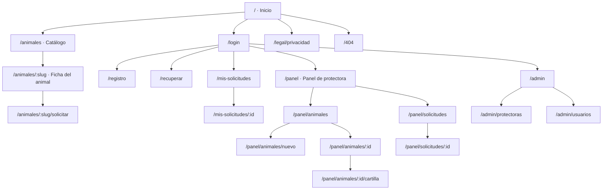

# 3.1.5. Diseño UX/UI

## 3.1.5.1. Público objetivo

El diseño se deriva del análisis: dos perfiles con contextos de uso muy distintos que comparten la misma aplicación.

| Dimensión | **Laura** · personal de protectora | **Carlos** · adoptante |
|---|---|---|
| Edad y rol | 34 años, coordinadora de acogidas | 29 años, empleado de oficina |
| Dispositivo principal | Móvil en el refugio, portátil en casa | Móvil |
| Contexto | De pie, con poco tiempo, a veces sin cobertura | En el sofá, comparando animales, con calma |
| Nivel digital | Medio | Alto |
| Objetivo | Registrar una vacuna en segundos y no duplicar trabajo | Ver si el animal encaja con su piso y saber cómo va su solicitud |
| Frustración actual | Pasar notas de papel a Excel y olvidar citas | Fichas incompletas y días sin respuesta |
| Necesidad de accesibilidad | Textos grandes, botones amplios, contraste alto | Navegación clara y formularios cortos |

**Perfil secundario:** personal sénior con baja alfabetización digital (citado en el análisis). El diseño no puede apoyarse en gestos, iconos sin etiqueta ni jerga técnica.

**Consecuencias de diseño**

- Formularios **de una sola columna**, con etiquetas visibles y ayudas contextuales.
- Acciones destructivas siempre con confirmación explícita.
- En móvil, las acciones principales quedan al alcance del pulgar.
- El estado de un animal o de una solicitud se comunica con **texto + color**, nunca solo con color.
- El panel prioriza velocidad: pocas pulsaciones para registrar una vacuna.

## 3.1.5.2. Arquitectura de información y navegación

### Mapa del sitio



### Reglas de navegación

| Regla | Detalle |
|---|---|
| Menú público | Inicio · Animales · Cómo adoptar · Acceder |
| Menú de adoptante | Mis solicitudes · Mi cuenta · Cerrar sesión |
| Menú de personal | Panel · Animales · Solicitudes · Cerrar sesión |
| Menú de administración | Protectoras · Usuarios · Cerrar sesión |
| Secciones por rol | **No se renderizan** las secciones que el rol no puede usar, y la API las rechaza igualmente |
| Móvil | Menú en panel deslizante con cierre por `Esc` y foco atrapado |
| Migas de pan | En fichas y paneles: `Panel / Animales / Luna / Cartilla` |
| Enlace de salto | "Saltar al contenido" como primer elemento enfocable |
| Estado activo | Marcado con `aria-current="page"` y subrayado, no solo con color |

### Recorridos principales

**Recorrido 1 · Adopción (Carlos)**

```text
Inicio → Catálogo (filtra "piso" y "perro") → Ficha (lee resumen de cartilla)
→ "Solicitar adopción" → Registro (si no tiene cuenta) → Formulario → Confirmación
→ Mis solicitudes (estado PENDIENTE) → ... → Estado APROBADA con contacto del centro
```

**Recorrido 2 · Registro sanitario (Laura)**

```text
Login → Panel → Animales → Luna → Cartilla → "Añadir vacuna"
→ Formulario (3 campos) → Guardado → La vacuna aparece arriba con la próxima dosis
```

**Recorrido 3 · Gestión de una solicitud (Laura)**

```text
Panel → Solicitudes (filtro "Pendientes") → Detalle (lee respuestas del formulario)
→ "Aprobar" → Confirmación con consecuencias → El animal pasa a adoptado
```

## 3.1.5.3. Wireframes

Se entregan como **maquetas HTML navegables** en [`mockups/`](mockups/), que se abren directamente en el navegador, responsive y sin dependencias externas. Permiten validar la estructura antes de programar y sirven de base para el frontend real. El mapa de archivos y las convenciones están en [`mockups/README.md`](mockups/README.md).

| # | Pantalla | Archivo | Elementos clave |
|---|---|---|---|
| 1 | Inicio | `mockups/index.html` | Propuesta de valor, buscador rápido, animales destacados, cómo funciona |
| 2 | Catálogo | `mockups/catalogo.html` | Filtros, rejilla de tarjetas, paginación, estado vacío |
| 3 | Ficha del animal | `mockups/ficha.html` | Galería, datos, resumen de cartilla, CTA fija en móvil |
| 4 | Formulario de solicitud | `mockups/solicitud.html` | Formulario por secciones, consentimiento, resumen de errores |
| 5 | Login y registro | `mockups/acceso.html` | Dos paneles, errores junto al campo, enlace de recuperación |
| 6 | Confirmación | `mockups/confirmacion.html` | Número de solicitud, siguientes pasos |
| 7 | Mis solicitudes | `mockups/mis-solicitudes.html` | Estados con texto, línea de tiempo, estado vacío |
| 8 | Panel · inicio | `mockups/panel.html` | Indicadores, accesos rápidos, próximas dosis |
| 9 | Panel · animales | `mockups/panel-animales.html` | Tabla responsive, acciones, alta |
| 10 | Cartilla Digital | `mockups/cartilla.html` | Secciones, formulario en línea, confirmación de borrado |
| 11 | Panel · solicitudes | `mockups/panel-solicitudes.html` | Filtros por estado, detalle lateral |
| 12 | Administración | `mockups/admin.html` | Protectoras y usuarios, roles, avisos |
| 13 | Estado de error / 404 | `mockups/error.html` | Mensaje útil, acción de vuelta |
| 14 | Perfil del adoptante | `mockups/perfil.html` | Datos de cuenta, rejilla 3× de mascotas (animal, raza, edad, vacunas pendientes), banda de consejos de salud |
| 15 | Mi cartilla (lectura) | `mockups/mi-cartilla.html` | Cabecera del animal, aviso de dosis pendiente, tratamientos en curso y anteriores, alergias, personalidad, observaciones, vacunas |

Las pantallas 14 y 15 añaden el espacio del adoptante una vez cerrada la adopción: el perfil lista sus mascotas y cada tarjeta abre la cartilla digital en modo lectura, con el detalle clínico visible pero no editable (ADR-07). La relación persona–animal que hace posible esta pantalla se apoya en la adopción aprobada y se detalla en el modelo de datos (sección 3.1.3).

Cada maqueta incluye además, en una sección final de la página, la muestra de **componentes y estados** (normal, hover, focus, disabled, loading, error, vacío, éxito), que se convierte en la referencia visual de la implementación.

## 3.1.5.4. Guía de estilos

### Principios visuales

1. **Cercanía sin infantilismo:** el producto trata animales, pero gestiona datos sensibles. Nada de ilustraciones caricaturescas en el panel.
2. **Contraste antes que tendencia:** cada color se elige por su ratio de contraste, no por moda.
3. **Consistencia:** un mismo estado se ve igual en toda la aplicación.
4. **Densidad controlada:** el panel es más denso que el catálogo.

### Colores

```css
:root {
  /* Marca */
  --color-primary-900: #14342B;  /* Texto sobre fondos claros, cabeceras */
  --color-primary-700: #1F5C4A;  /* Color principal, botones */
  --color-primary-500: #2A7A63;  /* Hover, enlaces */
  --color-primary-100: #DDEFE8;  /* Fondos suaves, etiquetas */
  --color-accent-700: #9A3412;
  --color-accent-500: #C2410C;  /* Acento, CTA secundaria */
  --color-accent-100: #FDE7DC;

  /* Neutros cálidos */
  --color-bg: #FAF8F5;
  --color-surface: #FFFFFF;
  --color-border: #E7E2DA;
  --color-text: #1C1917;
  --color-text-muted: #57534E;
  --color-text-inverse: #FFFFFF;

  /* Semánticos */
  --color-success: #1A7F37;
  --color-warning: #B45309;
  --color-error: #B42318;
  --color-info: #0B6BCB;

  /* Foco */
  --color-focus: #0B6BCB;
  --focus-ring: 2px solid var(--color-focus);
  --focus-offset: 2px;
}
```

**Contrastes comprobados** (sobre `#FFFFFF` y sobre `#FAF8F5`):

| Combinación | Ratio | Cumple |
|---|---|---|
| Texto `#1C1917` sobre `#FAF8F5` | 15,8:1 | AAA |
| Texto secundario `#57534E` sobre `#FAF8F5` | 7,0:1 | AAA |
| Blanco sobre primario `#1F5C4A` | 7,6:1 | AAA |
| Blanco sobre acento `#C2410C` | 5,1:1 | AA |
| Error `#B42318` sobre blanco | 6,6:1 | AA |
| Advertencia `#B45309` sobre blanco | 5,0:1 | AA |
| Informativo `#0B6BCB` sobre blanco | 5,3:1 | AA |

> Los ratios se verifican con una herramienta de contraste en la fase de implementación y se revisan si se ajusta cualquier token. Ningún estado se comunica solo con color.

### Tipografía

| Elemento | Valor |
|---|---|
| Familia | **Inter** (variable), con `system-ui, -apple-system, "Segoe UI", Roboto, sans-serif` como respaldo |
| Escala | 1,25 (12 · 14 · 16 · 20 · 25 · 31 · 39 · 49 px) |
| Cuerpo | 16 px / 1,6 — nunca menos en móvil |
| Títulos | Peso 600–700, `line-height` 1,2 |
| Texto auxiliar | 14 px / 1,5, color `--color-text-muted` |
| Longitud de línea | 60–75 caracteres (`max-width: 70ch`) |
| Números y fechas | `font-variant-numeric: tabular-nums` en tablas |

Jerarquía: `h1` 39 px, `h2` 31 px, `h3` 25 px, `h4` 20 px, cuerpo 16 px, auxiliar 14 px. **Un solo `h1` por página.**

### Espaciado, rejilla y anchos

| Token | Valor |
|---|---|
| Unidad base | 4 px |
| Escala | 4 · 8 · 12 · 16 · 24 · 32 · 48 · 64 · 96 |
| Ancho máximo de página | 1200 px |
| Ancho de lectura | 720 px |
| Rejilla del catálogo | 1 columna &lt; 640 px · 2 ≥ 640 · 3 ≥ 1024 · 4 ≥ 1280 |
| Separación entre tarjetas | 24 px |
| Radio de borde | 8 px (controles), 16 px (tarjetas), 999 px (etiquetas) |
| Sombra | `0 1px 2px rgba(28,25,23,.06), 0 4px 12px rgba(28,25,23,.06)` |

### Componentes

| Componente | Variantes | Estados obligatorios |
|---|---|---|
| **Botón** | Primario, secundario, fantasma, peligro, icono | Normal, hover, focus, active, disabled, loading |
| **Campo de texto** | Texto, correo, contraseña, número, búsqueda | Normal, focus, error, disabled, con ayuda, con contador |
| **Selector** | Nativo estilizado | Normal, focus, error, disabled |
| **Área de texto** | — | Normal, focus, error, contador |
| **Casilla y radio** | — | Normal, focus, error, disabled |
| **Tarjeta de animal** | Catálogo, compacta | Normal, hover, focus, con etiqueta de estado, sin imagen (respaldo) |
| **Tabla** | Panel | Normal, ordenada, vacía, carga, error; en móvil pasa a tarjetas |
| **Etiqueta de estado** | Disponible, reservado, adoptado, pendiente, en revisión, aprobada, rechazada, cancelada | Texto + color + icono con nombre accesible |
| **Alerta** | Éxito, advertencia, error, información | Con y sin acción |
| **Modal** | Confirmación destructiva, formulario corto | Foco atrapado, cierre con `Esc`, `aria-modal` |
| **Paginación** | — | Normal, página actual, disabled |
| **Carga** | Esqueleto de tarjeta, esqueleto de tabla, botón con spinner | — |
| **Estado vacío** | Sin resultados, sin datos, sin permisos | Ilustración simple + texto + acción |
| **Línea de tiempo** | Historial de solicitud | Normal, estado actual destacado |
| **Migas de pan** | — | Normal, enlace actual |

### Iconografía e imágenes

- Iconos de una sola familia, trazo de 2 px, siempre acompañados de texto o de `aria-label`.
- Fotografías reales de los animales, sin filtros que alteren el aspecto.
- Formato WebP/AVIF, `srcset`, `loading="lazy"` salvo la imagen principal de la ficha.
- **Texto alternativo obligatorio**, descriptivo y sin empezar por "imagen de".
- Sin imágenes de relleno que simulen animales inexistentes en el catálogo.

## 3.1.5.5. Estados de los componentes

Diseñar solo el caso ideal es el error más común. Cada pantalla clave define:

| Estado | Comportamiento | Ejemplo |
|---|---|---|
| **Normal** | Datos completos | Catálogo con 12 tarjetas |
| **Carga** | Esqueletos con la misma altura que el contenido final, sin saltos de maquetación | Rejilla de 12 esqueletos |
| **Vacío** | Explica por qué no hay datos y ofrece una acción | "No hay animales con estos filtros" + Limpiar filtros |
| **Error** | Mensaje comprensible, sin código técnico, con "Reintentar" | "No hemos podido cargar el catálogo" |
| **Éxito** | Confirmación breve y siguiente paso | "Vacuna registrada. Próxima dosis: 20/10/2027" |
| **Error de validación** | Resumen arriba + mensaje junto al campo + `aria-invalid` | "La motivación debe tener al menos 50 caracteres" |
| **Sin permisos** | Explica que no tiene acceso y ofrece volver | "Esta sección es solo para personal de protectora" |
| **Sesión caducada** | Aviso y redirección al login conservando el destino | "Tu sesión ha caducado. Vuelve a entrar" |

## 3.1.5.6. Formularios y validación

- Etiqueta **visible** y asociada con `for`/`id`; el placeholder no sustituye a la etiqueta.
- Campos obligatorios marcados con texto ("Obligatorio"), no solo con asterisco.
- Ayuda contextual con `aria-describedby`.
- Validación al enviar y al salir del campo; **nunca** mientras se escribe por primera vez.
- El error se muestra junto al campo y en un resumen al principio del formulario, con enlace a cada campo afectado.
- Se conserva lo introducido cuando hay un error (CA-03.6).
- El botón de envío pasa a estado *loading* y se desactiva para evitar dobles envíos.
- Confirmación explícita en operaciones destructivas: aprobar una adopción, eliminar un registro sanitario, archivar un animal, suprimir la cuenta.
- En móvil: teclados adecuados (`type="email"`, `inputmode="numeric"`), campos a ancho completo, sin scroll horizontal.

## 3.1.5.7. Diseño responsive

| Punto de ruptura | Cambios principales |
|---|---|
| **&lt; 480 px** | Una columna; menú lateral; CTA de la ficha fija abajo; tablas convertidas en tarjetas |
| **480–767 px** | Una columna con imágenes más grandes; filtros en panel deslizante |
| **768–1023 px** | Dos columnas en catálogo; panel con barra lateral colapsable |
| **1024–1279 px** | Tres columnas; panel con barra lateral fija |
| **≥ 1280 px** | Cuatro columnas; ancho máximo 1200 px |

**Reglas:** nada de scroll horizontal (salvo tablas con contenedor propio y aviso); imágenes fluidas; botones de al menos 44 × 44 px en móvil; el orden del DOM se mantiene igual al orden visual para no romper el foco del teclado.

## 3.1.5.8. Accesibilidad en el diseño

| Elemento | Decisión |
|---|---|
| Estructura | `header`, `nav`, `main`, `footer`; un `h1` por página; encabezados jerárquicos |
| Salto de contenido | Primer enlace: "Saltar al contenido" |
| Foco | Visible siempre, con anillo de 2 px y desplazamiento de 2 px; nunca `outline: none` sin sustituto |
| Contraste | Tokens verificados (tabla anterior); textos grandes ≥ 3:1 |
| Estados | Texto + color + icono con nombre accesible |
| Formularios | Etiquetas, ayudas, errores asociados y resumen de errores |
| Imágenes | Texto alternativo obligatorio en el alta (CA-05.1) |
| Modal | `role="dialog"`, `aria-modal="true"`, foco atrapado, cierre con `Esc`, foco devuelto al botón de origen |
| Carga | Región `aria-live="polite"` para anunciar resultados y errores |
| Objetivos táctiles | Mínimo 24 × 24 px; recomendado 44 × 44 en móvil |
| Reflujo | Funcional a 320 px y con zoom al 200 % |
| Movimiento | `prefers-reduced-motion` respetado |
| Autenticación | Sin pruebas cognitivas; se permite pegar contraseña y usar gestores |

Los wireframes incluyen el foco visible y los estados de error para que la accesibilidad se valide **desde el diseño** y no al final (error nº 9 de la guía).

## 3.1.5.9. Contenido y tono

- **Tono:** claro, directo y humano. "Luna busca familia", no "Registro de espécimen canino".
- **Microcopy de estados:** explica qué pasa y qué puede hacer la persona.
- **Errores:** "No hemos podido guardar la vacuna. Revisa la fecha de la próxima dosis", no "Error 422".
- **Confirmaciones:** dicen qué ha cambiado y qué ocurre después.
- **Sin culpabilizar:** en el rechazo de una solicitud se usa un motivo respetuoso y concreto.

## 3.1.5.10. Decisiones de UX que se justifican en la defensa

| Decisión | Alternativa descartada | Motivo |
|---|---|---|
| Filtros en la URL | Filtros solo en estado interno | Permite compartir un enlace ("mira este gato") y volver atrás sin perder el filtro |
| Cuenta obligatoria para solicitar | Formulario libre | Es la única forma de cumplir el estado en tiempo real (ADR-06) |
| Cartilla resumida en público | Cartilla completa | Minimización de datos (ADR-07) |
| Confirmación al aprobar | Aprobación en un clic | La acción es irreversible y afecta a otras personas |
| Tablas convertidas en tarjetas en móvil | Scroll horizontal de tablas | El scroll horizontal es un problema de accesibilidad y usabilidad en el refugio |
| Formulario en secciones | Un único formulario de 15 campos | Reduce el abandono y permite validar por bloques |
