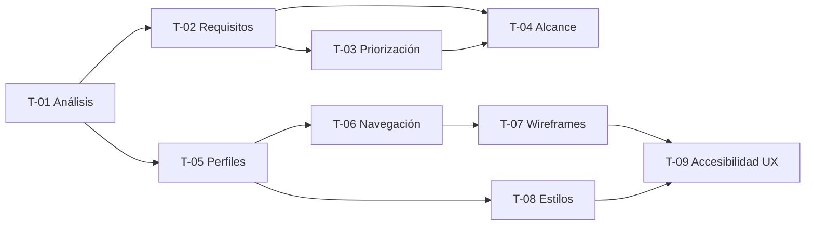
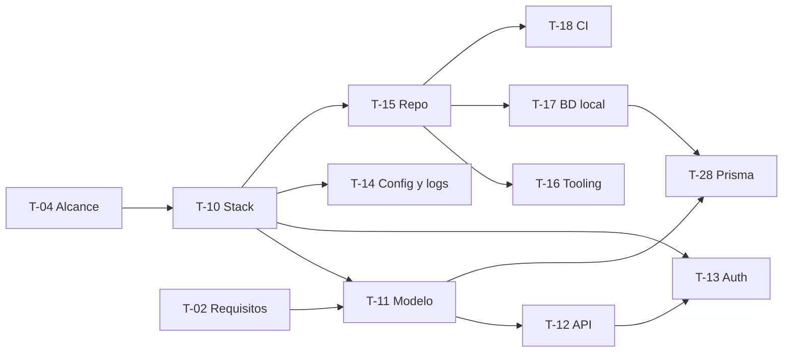
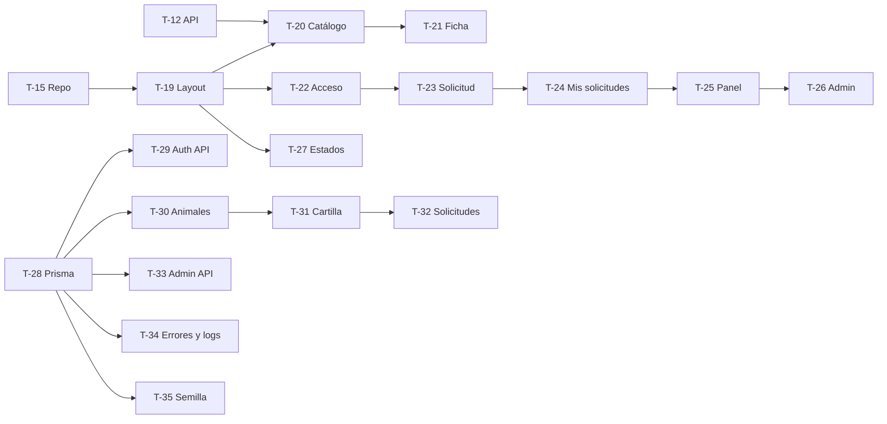
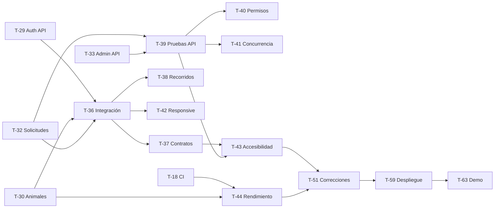

# 3.3. Fases, tareas y planificación

> **Nota de alcance:** la guía pide que este listado coincida con el apartado **4.2 de la planificación general**, pero ese apartado todavía no se ha elaborado y no forma parte de esta entrega. Los identificadores y duraciones de esta sección son la propuesta del equipo de diseño. Cuando exista el 4.2 se contrastarán ambos documentos para que no se contradigan (error nº 11 de la guía: «no alinear el diseño con la planificación»); hoy no hay nada que alinear.

## 3.3.1. Criterios de planificación

- **Equipo:** tres personas (G, I, X). Las tareas marcadas como paralelizables pueden repartirse.
- **Duración:** 9 horas de trabajo de diseño (3 semanas × 3 h) y una estimación de **≈ 96 h** de implementación, revisión y despliegue.
- **Prioridad:** `P1` imprescindible para el MVP, `P2` importante, `P3` deseable.
- **Definición de terminado:** código revisado, pruebas en verde, criterio de aceptación verificado, documentación actualizada y sin incidencias críticas de accesibilidad.

## 3.3.2. Bloques de trabajo

### Bloque 1 · Análisis y cierre de requisitos

| ID | Tarea | Depende de | Duración | Prioridad | Resultado esperado |
|---|---|---|---:|---|---|
| T-01 | Revisar el análisis y confirmar necesidades | — | 1 h | P1 | Necesidades priorizadas y alcance del MVP aprobado |
| T-02 | Redactar historias de usuario y criterios de aceptación | T-01 | 3 h | P1 | RF-01 a RF-12 con criterios verificables |
| T-03 | Priorizar con MoSCoW y detectar dependencias | T-02 | 1 h | P1 | Tabla de prioridades y mapa de dependencias |
| T-04 | Aprobar el alcance y los requisitos no funcionales | T-02, T-03 | 1 h | P1 | Requisitos congelados para el diseño |

### Bloque 2 · Diseño UX/UI

| ID | Tarea | Depende de | Duración | Prioridad | Resultado esperado |
|---|---|---|---:|---|---|
| T-05 | Definir público objetivo y recorridos | T-01 | 1 h | P1 | Perfiles y tres recorridos principales documentados |
| T-06 | Diseñar el mapa de navegación | T-05 | 1 h | P1 | Diagrama de navegación por rol |
| T-07 | Crear wireframes de baja fidelidad | T-06 | 4 h | P1 | 15 pantallas maquetadas y navegables |
| T-08 | Definir la guía de estilos y los componentes | T-05 | 2 h | P1 | Tokens de color, tipografía, espaciado y estados |
| T-09 | Revisar accesibilidad y responsive del diseño | T-07, T-08 | 1 h | P1 | Lista de problemas corregidos antes de programar |

### Bloque 3 · Diseño técnico y modelo de datos

| ID | Tarea | Depende de | Duración | Prioridad | Resultado esperado |
|---|---|---|---:|---|---|
| T-10 | Confirmar la arquitectura y el stack | T-04 | 1 h | P1 | Alternativa seleccionada y ADR registrados |
| T-11 | Diseñar el modelo de datos y las reglas de integridad | T-02, T-10 | 2 h | P1 | Esquema Prisma, diagrama E-R y reglas RI-01 a RI-16 |
| T-12 | Definir los contratos de API | T-11 | 2 h | P1 | Endpoints, permisos, errores y transiciones |
| T-13 | Diseñar autenticación y autorización | T-10, T-12 | 1 h | P1 | Sesión, matriz de permisos y pruebas de acceso |
| T-14 | Definir la estrategia de configuración y observabilidad | T-10 | 1 h | P2 | Variables de entorno, logs y health check |

### Bloque 4 · Preparación del entorno

| ID | Tarea | Depende de | Duración | Prioridad | Resultado esperado |
|---|---|---|---:|---|---|
| T-15 | Crear el repositorio y la estructura del monorepo | T-10 | 1 h | P1 | `apps/web`, `apps/api`, `packages/shared`, `docs/` |
| T-16 | Configurar TypeScript, ESLint y Prettier | T-15 | 1 h | P1 | `npm run lint` y `tsc --noEmit` funcionando |
| T-17 | Preparar PostgreSQL local con Docker y las variables de entorno | T-15 | 1 h | P1 | Base de datos reproducible con un comando |
| T-18 | Configurar CI y un despliegue de prueba temprano | T-15 | 2 h | P1 | Pipeline en verde y URL de *staging* accesible |

### Bloque 5 · Desarrollo frontend

| ID | Tarea | Depende de | Duración | Prioridad | Resultado esperado |
|---|---|---|---:|---|---|
| T-19 | Implementar layout, navegación y accesibilidad base | T-07, T-08, T-16 | 3 h | P1 | Cabecera, menú, pie, salto de contenido y foco |
| T-20 | Implementar el catálogo con filtros y paginación | T-19, T-12 | 4 h | P1 | RF-01 conectado a la API |
| T-21 | Implementar la ficha del animal y la galería | T-20 | 3 h | P1 | Ficha pública con resumen de cartilla |
| T-22 | Implementar registro, login y recuperación | T-19 | 3 h | P1 | RF-06, RF-07 y RF-11 |
| T-23 | Implementar el formulario de solicitud | T-22 | 4 h | P1 | RF-03 con validación y resumen de errores |
| T-24 | Implementar "Mis solicitudes" y la línea de tiempo | T-23 | 3 h | P1 | RF-08 y RF-09 |
| T-25 | Implementar el panel de protectora | T-24 | 6 h | P1 | Animales, cartilla y solicitudes (RF-02, RF-04, RF-05) |
| T-26 | Implementar la administración | T-25 | 3 h | P2 | RF-10 y RF-12 |
| T-27 | Implementar estados de carga, error, vacío y éxito | T-19 a T-25 | 3 h | P1 | Todas las pantallas con sus estados |

### Bloque 6 · Desarrollo backend

| ID | Tarea | Depende de | Duración | Prioridad | Resultado esperado |
|---|---|---|---:|---|---|
| T-28 | Crear el esquema Prisma y las migraciones | T-11, T-17 | 2 h | P1 | Base de datos creada y migraciones versionadas |
| T-29 | Implementar autenticación y sesiones | T-28, T-13 | 3 h | P1 | Registro, login, logout, `me` y recuperación |
| T-30 | Implementar el módulo de animales e imágenes | T-28 | 4 h | P1 | CRUD con aislamiento por protectora |
| T-31 | Implementar la cartilla y sus registros sanitarios | T-30 | 3 h | P1 | Vacunas, alergias y tratamientos validados |
| T-32 | Implementar solicitudes y máquina de estados | T-31 | 5 h | P1 | Transacciones, historial e índices únicos |
| T-33 | Implementar administración y permisos | T-32 | 3 h | P2 | Protectoras, usuarios y roles |
| T-34 | Implementar errores centralizados, validación y logs | T-28 | 2 h | P1 | Respuestas coherentes y trazabilidad |
| T-35 | Crear la semilla de datos | T-28 | 2 h | P1 | 3 protectoras y 30 animales con cartillas |

### Bloque 7 · Integración

| ID | Tarea | Depende de | Duración | Prioridad | Resultado esperado |
|---|---|---|---:|---|---|
| T-36 | Conectar cada pantalla con su endpoint | T-20 a T-26, T-29 a T-33 | 4 h | P1 | Recorridos completos de extremo a extremo |
| T-37 | Verificar contratos y códigos de error | T-36 | 2 h | P1 | Ninguna discrepancia entre API y frontend |
| T-38 | Probar los tres recorridos principales | T-36 | 2 h | P1 | Adopción, cartilla y gestión de solicitud |

### Bloque 8 · Pruebas y calidad

| ID | Tarea | Depende de | Duración | Prioridad | Resultado esperado |
|---|---|---|---:|---|---|
| T-39 | Pruebas de servicios y endpoints (CP-01 a CP-12) | T-32, T-33 | 5 h | P1 | Cobertura ≥ 60 % en `services` |
| T-40 | Pruebas de permisos e intentos no autorizados | T-39 | 2 h | P1 | IDOR y 403/404 verificados |
| T-41 | Prueba de concurrencia de aprobación (PoC-03) | T-39 | 1 h | P1 | Solo una aprobación posible |
| T-42 | Pruebas responsive en móvil, tablet y escritorio | T-36 | 2 h | P1 | Sin scroll horizontal ni elementos cortados |
| T-43 | Auditar accesibilidad (axe, teclado, contraste) | T-37 | 3 h | P1 | 0 incidencias graves y lista de correcciones |
| T-44 | Medir rendimiento (Lighthouse y k6) | T-18, T-30 | 2 h | P1 | RNF-01 medido y registrado |

### Bloque 9 · Refuerzo de seguridad

| ID | Tarea | Depende de | Duración | Prioridad | Resultado esperado |
|---|---|---|---:|---|---|
| T-45 | Revisar permisos del servidor y pertenencia | T-33 | 2 h | P1 | Matriz de permisos comprobada |
| T-46 | Revisar secretos, cabeceras y cookies | T-18 | 1 h | P1 | Sin secretos en el repositorio, cabeceras activas |
| T-47 | Revisar dependencias y exposición de errores | T-34 | 1 h | P1 | `npm audit` sin altas; errores sin detalles internos |
| T-48 | Verificar copia de seguridad y restauración | T-17 | 1 h | P2 | Restauración documentada y probada |

### Bloque 10 · SEO y accesibilidad

| ID | Tarea | Depende de | Duración | Prioridad | Resultado esperado |
|---|---|---|---:|---|---|
| T-49 | Metadatos, títulos, sitemap y `robots.txt` | T-20, T-21 | 2 h | P1 | HTML prerenderizado con metadatos correctos |
| T-50 | Revisar estructura semántica y encabezados | T-19 | 1 h | P1 | Sin saltos de nivel ni `h1` duplicados |
| T-51 | Corregir incidencias de accesibilidad y repetir la auditoría | T-43 | 3 h | P1 | Evidencias antes/después |
| T-52 | Verificar datos estructurados y metadatos sociales | T-49 | 1 h | P3 | Open Graph válido en las fichas |

### Bloque 11 · Documentación

| ID | Tarea | Depende de | Duración | Prioridad | Resultado esperado |
|---|---|---|---:|---|---|
| T-53 | README de instalación y ejecución | T-15 | 2 h | P1 | Otra persona arranca el proyecto siguiendo los pasos |
| T-54 | Documentar la arquitectura, el modelo y los endpoints | T-37 | 2 h | P1 | Documentación coherente con el código |
| T-55 | Mantener los ADR actualizados | Todo el proyecto | 1 h | P1 | Decisiones y cambios registrados |
| T-56 | Documentar pruebas, PoC y resultados | T-39, T-44 | 2 h | P1 | Evidencias con fecha y commit |
| T-57 | Guía básica de uso por rol | T-36 | 1 h | P2 | Manual breve para la demostración |

### Bloque 12 · Despliegue y cierre

| ID | Tarea | Depende de | Duración | Prioridad | Resultado esperado |
|---|---|---|---:|---|---|
| T-58 | Configurar producción y variables | T-18 | 1 h | P1 | Entorno de producción listo |
| T-59 | Desplegar y verificar la conexión con la base de datos | T-58 | 1 h | P1 | `/health` en verde |
| T-60 | Pruebas de humo y permisos en producción | T-59 | 1 h | P1 | Recorridos principales funcionando |
| T-61 | Revisar logs y errores del despliegue | T-59 | 1 h | P1 | Sin errores inesperados |
| T-62 | Documentar URL, despliegue y limitaciones conocidas | T-60 | 1 h | P1 | Entrega verificable |
| T-63 | Preparar la demostración final | T-60 | 2 h | P1 | Guion de demo con datos sembrados |

## 3.3.3. Dependencias entre tareas

Cada flecha significa «depende de»: la tarea de destino no empieza hasta que termina la de origen. Para que el grafo se lea bien en pantalla y en papel, se reparte en cuatro diagramas, uno por grupo de bloques de 3.3.2.

**Bloques 1 y 2 · Análisis, requisitos y diseño UX**

**Bloques 3 y 4 · Arquitectura, datos y entorno**

**Bloques 5 y 6 · Desarrollo frontend y backend**

**Bloques 7 a 12 · Integración, calidad y entrega**

### Camino crítico

`T-01 → T-02 → T-11 → T-28 → T-32 → T-36 → T-39 → T-43 → T-51 → T-59 → T-63`

Cualquier retraso en el modelo de datos o en la máquina de estados de las solicitudes desplaza la entrega completa. Por eso esas dos tareas son las primeras que se atacan en la fase de implementación.

### Trabajo paralelizable

- **Persona 1:** backend de animales y cartilla (T-30, T-31) mientras **persona 2** construye layout, catálogo y ficha (T-19 a T-21).
- **Persona 3:** autenticación (T-29, T-22) y, en paralelo, la semilla de datos (T-35).
- La documentación (T-53 a T-57) se reparte y se actualiza al cerrar cada bloque, no al final.

## 3.3.4. Estimación y distribución

| Bloque | Horas |
|---|---:|
| 1 · Análisis y requisitos | 6 |
| 2 · UX/UI | 8 |
| 3 · Diseño técnico | 7 |
| 4 · Entorno | 5 |
| 5 · Frontend | 29 |
| 6 · Backend | 24 |
| 7 · Integración | 8 |
| 8 · Pruebas y calidad | 15 |
| 9 · Seguridad | 5 |
| 10 · SEO y accesibilidad | 7 |
| 11 · Documentación | 8 |
| 12 · Despliegue y cierre | 7 |
| **Total** | **≈ 129 h** |

La cifra incluye diseño (9 h) y trabajo de implementación. Con tres personas, equivale a unas **43 h por persona**, asumibles en el calendario del módulo si se respeta el MVP y no se añaden funcionalidades *Could* antes de cerrar las *Must*.

## 3.3.5. Gestión y seguimiento

| Aspecto | Herramienta | Regla |
|---|---|---|
| Tareas | GitHub Projects (tablero por bloques) | Cada tarea tiene ID, criterio de terminado y requisito asociado |
| Código | Git con ramas por tarea y *pull request* revisado | Nadie fusiona su propio PR sin revisión |
| Convención de commits | Conventional Commits (`feat:`, `fix:`, `docs:`, `test:`) | Trazabilidad entre tarea y cambio |
| Reunión semanal | 30 minutos | Revisar bloque, riesgos y bloqueos |
| Riesgos | Tabla de 3.2.5 | Se revisa en cada reunión |
| Evidencias | `docs/` y capturas en los anexos | Cada prueba y PoC deja registro |

## 3.3.6. Encaje previsto con el apartado 4.2

El apartado 4.2 se elaborará en una fase posterior. Esta tabla no afirma una equivalencia cerrada: deja preparado el encaje para contrastarlo cuando exista.

| Bloque de este documento | Equivalencia prevista en 4.2 | Estado |
|---|---|---|
| 1 · Análisis y cierre | Fase de análisis | Cubierto |
| 2 · UX/UI | Diseño de interfaz | Cubierto |
| 3 · Diseño técnico | Modelo de datos y API | Cubierto |
| 4 · Entorno | Preparación | Se contrastará |
| 5 · Frontend | Desarrollo cliente | Se contrastará |
| 6 · Backend | Desarrollo servidor | Se contrastará |
| 7 · Integración | Integración | Se contrastará |
| 8 · Pruebas | Pruebas | Se contrastará |
| 9 · Seguridad | Refuerzo | Se contrastará |
| 10 · SEO y accesibilidad | Calidad | Se contrastará |
| 11 · Documentación | Memoria | Se contrastará |
| 12 · Despliegue | Entrega | Se contrastará |

> **Siguiente paso, cuando toque:** al elaborar el 4.2, revisar identificadores, duraciones y responsables para que ambos documentos coincidan. No es una tarea de la fase de diseño ni bloquea su cierre.
