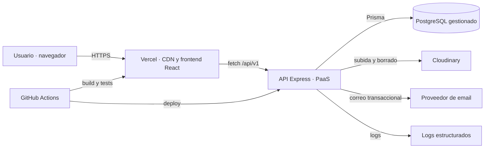

# Anexos

## A. Lista de comprobación de la entrega

### Requisitos

- [x] Se han definido las historias de usuario principales (RF-01 a RF-12).
- [x] Las historias tienen criterios de aceptación comprobables (formato Dado/Cuando/Entonces).
- [x] Las funcionalidades están priorizadas con MoSCoW.
- [x] Los requisitos no funcionales incluyen criterios verificables.
- [x] Se ha justificado qué aspectos son relevantes y cuáles quedan fuera.

### Datos y API

- [x] Se ha elaborado el modelo de datos con entidades, atributos y relaciones.
- [x] Las entidades y relaciones son coherentes con los requisitos.
- [x] Se han identificado las restricciones importantes (RI-01 a RI-16).
- [x] Se han documentado los endpoints principales.
- [x] Se han definido errores y permisos relevantes.
- [x] Los contratos de API coinciden con los requisitos y con la matriz de permisos.

### UX/UI

- [x] Se ha definido el público objetivo y sus contextos de uso.
- [x] Se ha diseñado la navegación por rol.
- [x] Existen wireframes de los recorridos principales (maquetas HTML).
- [x] La guía de estilos define colores, tipografía, espaciado y componentes.
- [x] Se han identificado los componentes reutilizables.
- [x] Se contemplan estados de carga, error, vacío, éxito y validación.
- [x] Se ha definido el comportamiento responsive.
- [x] Se han considerado los criterios WCAG 2.2 AA desde el diseño.

### Viabilidad técnica

- [x] Se han descrito tres alternativas viables y completas.
- [x] Se han concretado las tecnologías relevantes de cada alternativa.
- [x] La matriz utiliza criterios del proyecto y pesos que suman 100 %.
- [x] Las puntuaciones están justificadas.
- [x] Se han revisado costes y límites, con advertencia de fecha de consulta.
- [x] Se han definido las PoC necesarias.
- [ ] Las PoC están ejecutadas y sus resultados registrados.
- [x] Se ha seleccionado y justificado una solución.
- [x] Se han identificado riesgos y medidas de mitigación.
- [x] Se han previsto alternativas para los componentes críticos.

### Planificación

- [x] El trabajo está dividido en tareas con identificador.
- [x] El listado de tareas está preparado para contrastarse con el apartado 4.2 cuando se elabore (no es requisito de esta fase).
- [x] Se han identificado dependencias y camino crítico.
- [x] Se conocen los resultados esperados de cada tarea.
- [x] El alcance es realista y está priorizado.
- [x] Se han incluido pruebas, seguridad, documentación y despliegue.
- [x] El diseño final está representado mediante diagramas y maquetas.

### Coherencia global

- [x] Las decisiones responden a necesidades identificadas.
- [x] Los requisitos se relacionan con tareas de desarrollo.
- [x] Las tareas se relacionan con pruebas.
- [x] Los diagramas representan la solución seleccionada.
- [x] No hay contradicciones conocidas; el contraste con el 4.2 se hará cuando exista ese apartado.
- [x] Se han documentado las limitaciones conocidas.

## B. Registro de pruebas de concepto

Cada PoC se registra con la pregunta, la hipótesis, el procedimiento, el entorno, el resultado, las limitaciones y la consecuencia para la decisión.

| ID | Pregunta | Estado | Fecha | Resultado | Consecuencia |
|---|---|---|---|---|---|
| PoC-01 | Conexión estable API ↔ PostgreSQL gestionado | Pendiente | — | — | — |
| PoC-02 | Catálogo p95 &lt; 800 ms con 5.000 animales | Pendiente | — | — | — |
| PoC-03 | Una sola aprobación concurrente por animal | Pendiente | — | — | — |
| PoC-04 | Subida y borrado de imágenes en Cloudinary | Pendiente | — | — | — |
| PoC-05 | Modal usable solo con teclado y lector de pantalla | Pendiente | — | — | — |

**Plantilla de registro**

```markdown
### PoC-xx · Título

- **Pregunta:**
- **Hipótesis:**
- **Procedimiento:** pasos ejecutados
- **Entorno:** versión de Node, proveedor de base de datos, región, commit
- **Datos:** volumen y origen
- **Resultado:** métricas o captura
- **Limitaciones:** qué no demuestra la prueba
- **Decisión:** qué se mantiene o cambia
```

## C. Diagramas incluidos

| Diagrama | Ubicación | Tipo |
|---|---|---|
| Trazabilidad problema → requisito | [00-portada-e-introduccion.md](00-portada-e-introduccion.md#302-relación-con-el-análisis) | Tabla |
| Entidad-relación | [03-modelo-de-datos.md](03-modelo-de-datos.md#3133-diagrama-entidad-relación) | Mermaid `erDiagram` |
| Navegación y mapa del sitio | [05-ux-ui.md](05-ux-ui.md#3152-arquitectura-de-información-y-navegación) | Mermaid `flowchart` |
| Secuencia de aprobación | [04-contratos-api.md](04-contratos-api.md#diagrama-de-secuencia-aprobar-una-solicitud) | Mermaid `sequenceDiagram` |
| Dependencias de tareas | [07-planificacion-tareas.md](07-planificacion-tareas.md#333-dependencias-entre-tareas) | Mermaid `flowchart` |
| Arquitectura y despliegue | [06-viabilidad-tecnica.md](06-viabilidad-tecnica.md#325-elección-de-la-alternativa-y-justificación) y resumen en este anexo | Mermaid `flowchart` |

### Maquetas entregadas

Quince pantallas HTML navegables en [`mockups/`](mockups/), con sistema de diseño propio en `mockups/assets/estilos.css` y comportamientos de demostración en `mockups/assets/app.js`. El mapa de archivos, las rutas previstas y las convenciones están en [`mockups/README.md`](mockups/README.md).

| # | Pantalla | Archivo |
|---|---|---|
| 1 | Inicio | `mockups/index.html` |
| 2 | Catálogo | `mockups/catalogo.html` |
| 3 | Ficha del animal | `mockups/ficha.html` |
| 4 | Solicitud de adopción | `mockups/solicitud.html` |
| 5 | Acceso y registro | `mockups/acceso.html` |
| 6 | Confirmación | `mockups/confirmacion.html` |
| 7 | Mis solicitudes | `mockups/mis-solicitudes.html` |
| 8 | Panel · inicio | `mockups/panel.html` |
| 9 | Panel · animales | `mockups/panel-animales.html` |
| 10 | Cartilla digital | `mockups/cartilla.html` |
| 11 | Panel · solicitudes | `mockups/panel-solicitudes.html` |
| 12 | Administración | `mockups/admin.html` |
| 13 | Errores (404 · 500 · 403 · 401) | `mockups/error.html` |

### Arquitectura de despliegue (resumen)



## D. Referencias técnicas

### Normativa y accesibilidad

1. Fundación Affinity. (2024). *Estudio sobre abandono y adopción de animales de compañía en España*. https://www.fundacion-affinity.org/
2. Gobierno de España. (2023). *Ley 7/2023, de protección de los derechos y bienestar de los animales*. BOE. https://www.boe.es/buscar/doc.php?id=BOE-A-2023-7936
3. AEPD. (2018). *Ley Orgánica 3/2018, de Protección de Datos Personales y garantía de los derechos digitales*. https://www.aepd.es/
4. W3C. (2023). *Web Content Accessibility Guidelines (WCAG) 2.2*. https://www.w3.org/TR/WCAG22/
5. W3C. (2024). *WAI-ARIA Authoring Practices Guide*. https://www.w3.org/WAI/ARIA/apg/
6. Nielsen, J. (1994). *Usability Engineering*. Academic Press.

### Tecnologías

7. Meta. *React documentation*. https://react.dev/
8. Vite. *Vite documentation*. https://vite.dev/guide/
9. OpenJS Foundation. *Express documentation*. https://expressjs.com/
10. Prisma. *Prisma ORM documentation*. https://www.prisma.io/docs
11. Prisma. *Prisma Postgres*. https://www.prisma.io/docs/postgres
12. PostgreSQL Global Development Group. *PostgreSQL documentation*. https://www.postgresql.org/docs/
13. Vercel. *Vercel documentation*. https://vercel.com/docs
14. Cloudinary. *Cloudinary documentation*. https://cloudinary.com/documentation
15. GitHub. *GitHub Actions documentation*. https://docs.github.com/actions

### Calidad y seguridad

16. OWASP. *Application Security Verification Standard (ASVS)*. https://owasp.org/www-project-application-security-verification-standard/
17. OWASP. *Top 10*. https://owasp.org/www-project-top-ten/
18. Google. *Lighthouse documentation*. https://developer.chrome.com/docs/lighthouse
19. Deque. *axe DevTools*. https://www.deque.com/axe/
20. Grafana. *k6 documentation*. https://k6.io/docs/

> Las URLs se han consultado durante la fase de diseño (noviembre de 2026). Los planes y límites de los servicios deben verificarse en la fecha de implementación.

## E. Limitaciones conocidas

| Limitación | Impacto | Decisión |
|---|---|---|
| SPA con renderizado en cliente | El HTML inicial no contiene la ficha sin prerender | Mitigado con prerender de rutas públicas (ADR-01) |
| Sin recordatorios automáticos | No hay avisos por correo en el MVP | Fase 2 con `proximaDosis` ya modelado (ADR-08) |
| Correo transaccional sin proveedor elegido | RF-11 queda funcional pero sin envío real en desarrollo | Se registra en log y se integra antes de la entrega |
| Sin exportación de contrato en PDF | Trámite parcialmente manual | Fuera del MVP |
| Retención de datos propuesta, no validada legalmente | Riesgo de incumplimiento si se publica | Revisión antes de la entrega |
| Planes gratuitos | Límites de datos, conexiones y ancho de banda | Medición y plan B documentados |
| Sin pruebas con usuarios reales | El diseño no está validado con una protectora | Prueba con una persona externa al equipo antes de la demo |
| Sin pentest | Cobertura de seguridad limitada | Revisión de permisos, `npm audit` y pruebas de acceso indebido |

## F. Próximos pasos

1. Revisar las maquetas HTML navegables con el equipo y con una persona externa a la protectora.
2. Contrastar la planificación con el apartado 4.2 cuando se elabore; no bloquea el cierre de esta fase.
3. Ejecutar PoC-01 a PoC-05.
4. Revisar textos legales y política de retención.
5. Comenzar la implementación por el modelo de datos y la autenticación.
6. Desplegar un entorno de prueba en la primera semana de desarrollo.
